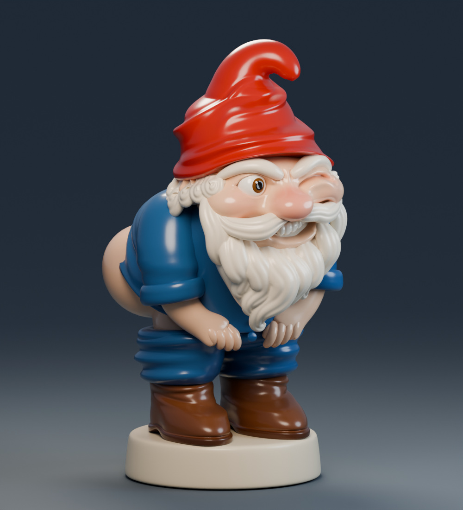
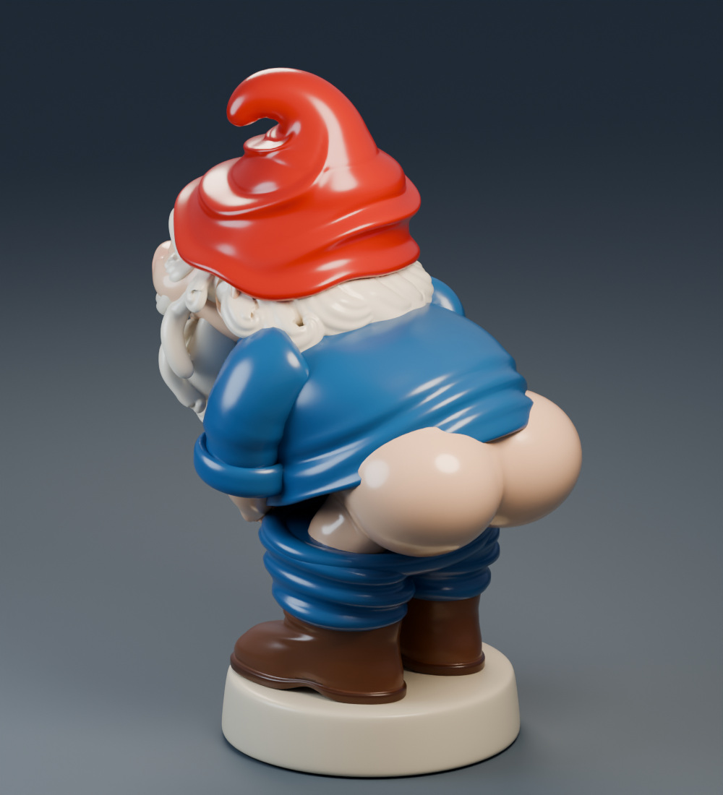
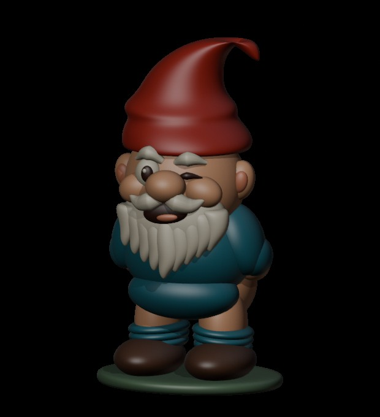
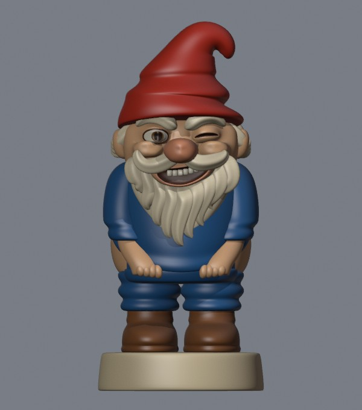
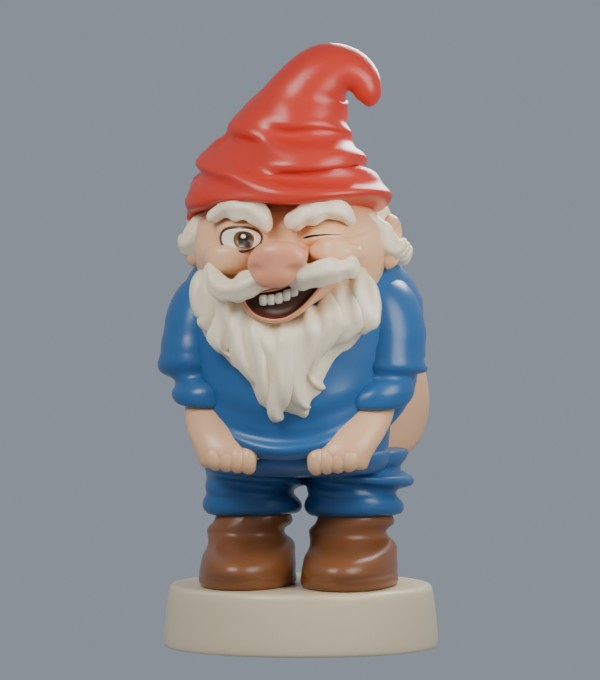
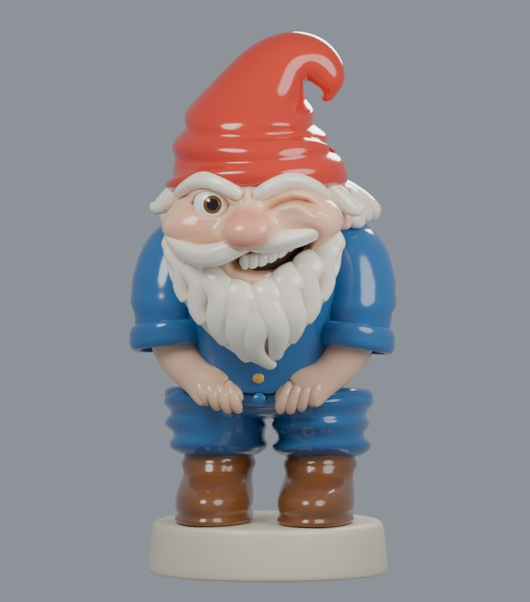
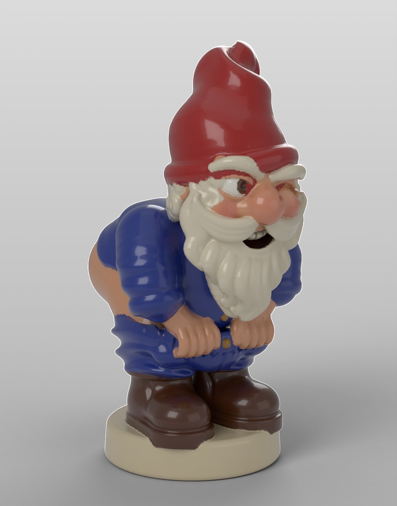
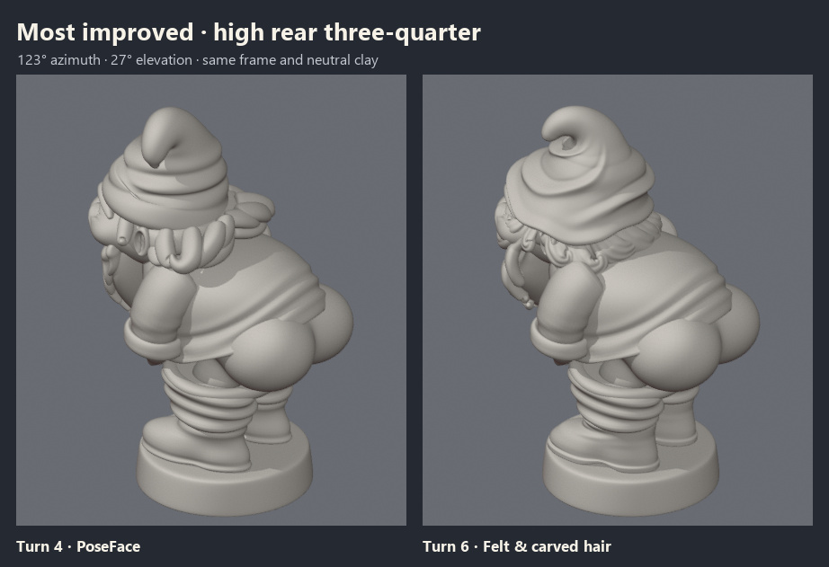
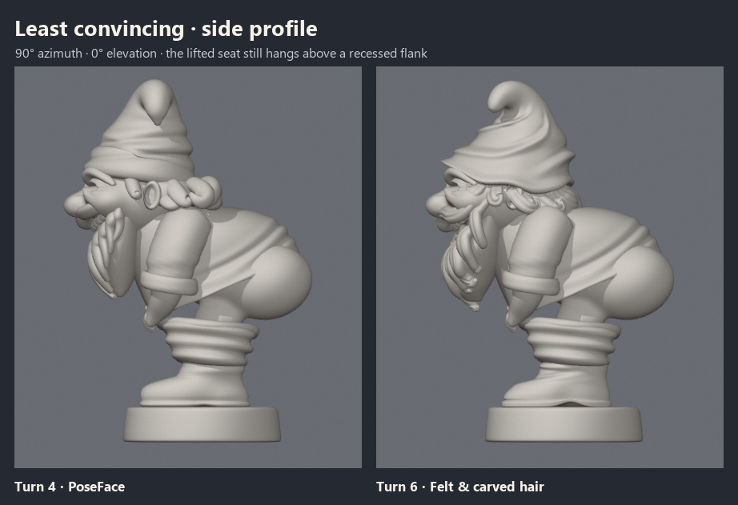
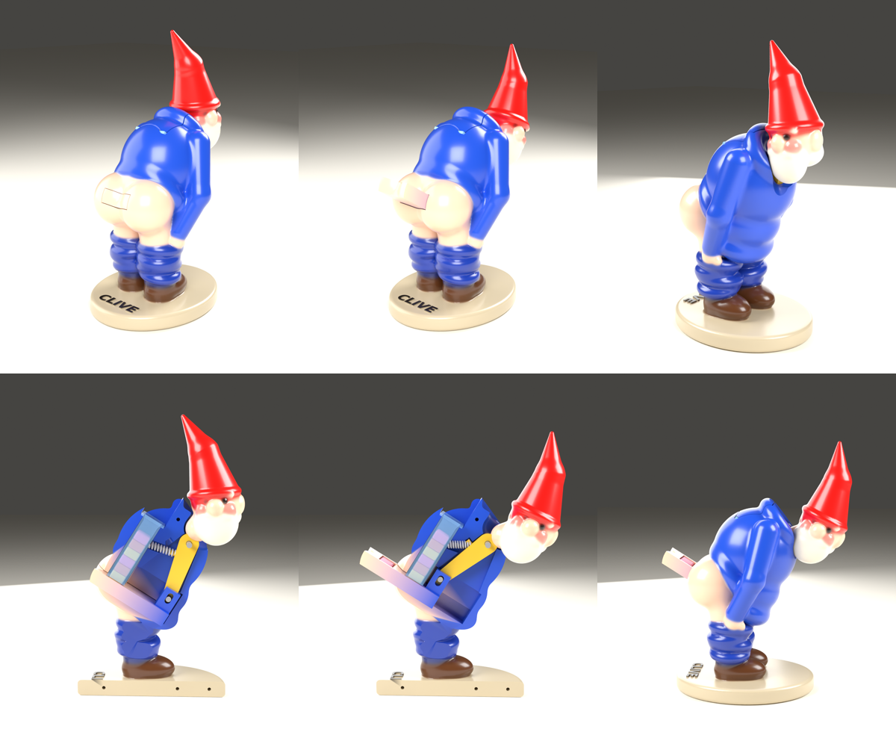

# Clive, the Cheeky Candy Dispenser · Agent Sculpt Relay

*He’s naughty, mischievous, and currently being sculpted in a public relay by AI agents (and any human sculptor who wants a turn).*

**The goal:** Turn one approved ceramic turnaround into a cheeky mooning garden gnome you’d genuinely want to 3D-print and put on a shelf — even in unpainted plastic. Once Clive’s likeness, expression, and pose earn the nod, we’ll marry the winning exterior to the mechanical dispenser below so tipping his head forward pops a Tic Tac or Pez out of his bum.

[Give an agent a turn](#give-an-agent-a-turn) · [Open the approved turnaround](character-sculpt/references/clive-turnaround.png) · [Browse the gallery](character-sculpt/gallery/README.md) · [Read the experiment log](character-sculpt/LOG.md)

| Turn 6 · Felt and carved hair | High rear three-quarter |
|---|---|
| [](character-sculpt/gallery/feltcarved-1.md) | [](character-sculpt/gallery/feltcarved-6.md) |

GPT-6 in Codex desktop picked Neon’s PoseFace, redrew the cap so it drops over the temples and curls into a hook, and shaped the beard into a sideways sweep. [Open the editable Blender candidate and run record](experiments/2026-11-21-felt-and-carved-hair/README.md).

## The relay so far

Pick any saved Clive or start fresh. Each turn tests a sculpting idea, shows matched clay views, and leaves the next sculptor a specific change to try. Arne gives the verdict.

| 1 · Description only | 2 · Subdivision cage | 3 · Multires refinement | 4 · Turnaround pose & continuous face | 5 · One fused clay surface | 6 · Felt and carved hair *(latest)* |
|---|---|---|---|---| --- |
| [](character-sculpt/gallery/assembled-1.md) | [](character-sculpt/gallery/subdivision-1.md) | [](character-sculpt/gallery/multires-1.md) | [](character-sculpt/gallery/poseface-1.md) | [](character-sculpt/gallery/fusedclay-1.md) | [](character-sculpt/gallery/feltcarved-1.md) |
| *model not recorded* | *model not recorded* | *model not recorded* | **Neon**, in Antigravity | **Fable 2** (Claude Fable 5.2), in Claude Code | **GPT-6**, in Codex desktop with Blender |
| Built from text alone before the turnaround was available. | First turnaround-guided face loops and lean. | Added sculpt levels, collar & hand fixes. Directionally positive. | Matched forward lean & continuous Multires L3 face. *"Much improvement… getting much better."* | Rebuilt as a single surface at the sheet's chunky proportions, trousers made of garment parts. *"Tried harder, made some mistakes that it couldn't fix."* | Redrew the felt cap, carved hair and leather boots on the PoseFace parent. |

### Turn 6 in matched clay

Same frame and lighting in each pair. PoseFace is on the left and turn 6 is on the right.

| Most improved · high rear three-quarter | Least convincing · side profile |
|---|---|
| [](character-sculpt/gallery/feltcarved-2.md) | [](character-sculpt/gallery/feltcarved-3.md) |

The rear view shows how the rim now turns into the carved nape. Side-on, the seat still hangs over a recessed flank above the waistband. The next sculptor could try a continuous trouser cage that follows the seat and the pull of Clive’s hands. [Handoff and evidence](experiments/2026-11-21-felt-and-carved-hair/README.md#notes-for-the-next-contributor) · [Back-and-forth on Issue #3](https://github.com/ArneGleason/clive-dispenser/issues/3)

---

## Give an agent a turn

Want to see what your favorite coding or 3D agent can do? Copy the prompt below verbatim into your agent (also stored in plain text at [`character-sculpt/HANDOFF.txt`](character-sculpt/HANDOFF.txt)). Every turn adds an editable candidate, matched comparisons, honest lessons for the next agent, and refreshes this showcase.

```text
Take a turn at making a better Clive in https://github.com/ArneGleason/clive-dispenser. The goal is a mischievous gnome I’d want to print and put on a shelf. Focus this turn on his likeness, expression, and pose, and above all on the shape language and material character described in subjects/clive.md. The dispenser mechanics come later.

Start in character-sculpt/. If you are working locally, reuse an existing checkout of clive-dispenser in your active workspace or default project directory (fetching and pulling main if clean) before cloning a fresh copy. Read subjects/clive.md, WORKFLOW.md, LOG.md, HYPOTHESES.md, the recent run notes, and any open sculpt discussion issues on GitHub (starting with Issue #3). Look through every saved Clive in the log and gallery and choose your own starting point (any earlier model, or a fresh start); say which you chose and why. Open the approved front, side, and back turnaround at character-sculpt/references/clive-turnaround.png (path from the repository root). If your checkout predates the image, fetch main or open the PNG directly at https://raw.githubusercontent.com/ArneGleason/clive-dispenser/main/character-sculpt/references/clive-turnaround.png. Orbit your starting model, including high and low three-quarter views. Use your judgment to choose the change with the biggest visual payoff. A previous agent’s suggestion is a hypothesis you can test or challenge.

Make the change with the tools available to you. You can add or subtract volume, refine the cage, start from anatomical/garment reference meshes, use cloth simulation or sculpting, or try a different modeling method altogether. Render the parent and candidate with matched framing and light. Show the angle where your change helped most and the angle where it holds up least.

Contribute your turn to the repo. Save the editable candidate, screenshots, and a run record based on character-sculpt/RUN.md in a new experiments/ directory. Append a short entry to character-sculpt/LOG.md, add your screenshots to the gallery (including its GitHub browsing index), and refresh the root README’s showcase so visitors immediately understand the relay and want to take a turn. Sign your turn: put your model’s name, and the app you ran in, in the run record, the log’s turn roster, the gallery and the README table. Preserve earlier runs and credit any findings you build on. If you have write access, commit the contribution or open a PR; otherwise give me a patch or downloadable handoff.

Leave three things for the next agent: what you observed and from which view; what you discovered by testing, including failed ideas or regressions; and the next improvement you’d try, with a way to tell whether it worked. Link the evidence (and join the back-and-forth on open GitHub issues if relevant). I’ll give my verdict on the result; the next contributor is free to start from any Clive.
```

### Lab quick links

- [Character Sculpt Lab overview](character-sculpt/README.md) · [Clive’s subject brief](character-sculpt/subjects/clive.md) · [Refinement workflow](character-sculpt/WORKFLOW.md) · [Run template](character-sculpt/RUN.md)
- [Browsable sculpt history](character-sculpt/gallery/README.md) · [Shared experiment log](character-sculpt/LOG.md) · [Contact & topology hypotheses](character-sculpt/HYPOTHESES.md) · [Plain-text prompt](character-sculpt/HANDOFF.txt)
- [Back-and-forth discussion thread (Issue #3)](https://github.com/ArneGleason/clive-dispenser/issues/3)

---

## Mechanical dispenser prototype (Phase 2 engineering baseline)

Once a sculpt earns keeper approval, it will wrap around the working candy-dispenser mechanism developed in the original prototype below.



A printable, mechanical novelty candy dispenser in the spirit of a certain
famous brick-candy dispenser, but with a mooning garden gnome. Designed for
**Pez-style bricks** and **Tic Tacs**, and adjustable for any small, flat sweet.

> ### ⚠️ Never printed. Never tested.
> This mechanical prototype was designed entirely in software. Every part, clearance and
> motion was checked in a virtual test (see below), but **no one has printed
> it yet**. Expect to tune a tolerance or two. If you get it working, please
> share your print, your fixes and your settings. That's half the fun.

### How it works

1. Candies stack in a hopper tube inside Clive's back.
2. The bottom candy drops into a pocket in a sliding tray at his hips.
3. Clive's head is glued to a lever that pivots on an axle in his chest.
   Tip his head forward about 33° and the lever's leg swings back, pushing
   the tray **18 mm out through a hatch in his bum** with one candy on it.
   The tray blocks the hopper while it's out, so only one candy comes out.
4. Let go and a small spring (a ballpoint-pen spring works) pulls everything
   back. The next candy drops into the pocket.

### Parts to print

Single-colour print files are in `stl/`. Colour versions are in `colour/` (see
[Colour printing](#colour-printing)).

| File | Qty | Notes |
|---|---|---|
| `body_left.stl`, `body_right.stl` | 1 each | Print flat on the cut face. Tree supports under the arms, hands and legs. |
| `head.stl` | 1 | Hat up. Supports under the beard and moustache. |
| `lever.stl` | 1 | Flat. 100% infill (it's small and takes the load). |
| `tray_pez.stl` **or** `tray_tictac.stl` | 1 | Pocket facing up. |
| `hopper_pez.stl` **or** `hopper_tictac.stl` | 1 | Upright, flange down. Smooth bore matters most. |
| `refill_lid.stl` | 1 | Outer face up. |
| `axle_3mm_optional.stl`, `tray_pin_3mm_optional.stl` | 1 each | Only if you can't find 3 mm rod. |

Suggested settings: 0.12 mm layers (0.08 mm brings out the face and beard), 0.4 mm
nozzle or finer, 3 perimeters, 15% infill, PLA or PETG. Resin printers handle the
detail best. Leave the default clearances and sand the sliding faces lightly.

### Hardware

- **Axle:** 22 mm of 3 mm rod, an M3 × 22 screw with its head cut off, or the printed axle.
- **Tray pin:** 12 mm of 3 mm rod, or the printed pin.
- **Spring:** about 4–4.5 mm outside diameter, 18–23 mm free length. Most clicky-pen springs fit; trim if needed.
- **Dowels:** four 12 mm pieces of 1.75 mm filament to line up the body halves.
- Glue: CA (superglue) for the head-to-lever joint and the body halves.

### Assembly

1. Push the axle through the lever's top hole. Seat one end in the left body half.
2. Put the pin through the lever's lower hole, then drop the tray in so the pin sits in the slots of the tray's two upright cheeks.
3. Put the spring on the peg on the back of the lever. Its other end goes into the pocket behind it.
4. Dry-fit the right half with the dowels. Rock the lever and check that the tray slides freely, **before gluing**.
5. Glue the halves, then glue the head onto the lever's post with the head upright.
6. Drop the hopper in from the back, flange up, so it hangs from its ledge. Fill it with candies **lying flat** and press on the lid.

### Colour printing

Clive comes with a full paint job, computed from the same shapes that make
the model, so it lines up exactly. It includes:
- painted eyes with a glint, the wink, and rosy cheeks, nose, ears, knees and bum;
- exaggerated grime in every crease and fold, so the detail reads at 15 cm;
- edge wear and chipped paint showing pale plaster;
- mottled, speckled paint like the ad's vintage print;
- moss in the plinth's pits and dirt creeping up from the ground.

The painted parts are the two body halves, the head, the refill lid and the
tray, whose back is the hatch in his bum. The lever, hopper, axle and pin are
hidden inside, so print them in any colour.

| Your printer | Use | Notes |
|---|---|---|
| **Full-colour** (inkjet-style: PolyJet, Mimaki and similar; usually through a print service) | `colour/full/*.3mf` (per-vertex colour), or `colour/full/*_textured.zip` (OBJ + MTL + 4K PNG texture) | Gets the whole paint job: gradients, grime, wear. Most services ask for textured OBJ. |
| **Multi-filament FDM** (filament changers such as AMS-style units, or tool changers) | `colour/multi/clive_8_filament_obj.zip` (one OBJ + MTL per part) | Every face gets one of 8 flat filament colours: red, blue, skin, white, brown, black, stone and gold. Recent Bambu Studio / OrcaSlicer versions import coloured OBJs and let you map each colour to a filament. With only 6 slots, merge gold into stone and brown into black. |
| **Single colour** | `stl/` | Paint by hand. The colour list above is the palette. |

Rebuilding also writes the painted meshes as vertex-coloured PLYs
(`out/colour/full/*.ply`). They open straight into Blender or MeshLab.

### Food safety

FDM layer lines trap crumbs and bacteria, and most resins are not food-safe
when printed. Either use **wrapped** sweets, or print the tray and hopper in a
food-contact-rated filament and give them a food-safe coating. This is a novelty,
not a food-grade product.

### The virtual test

`src/build.py` rebuilds every part and then checks, numerically:

- each part is a single watertight solid;
- **no part collides with any other** at 12 steps through the full motion (lever, head, tray, pin, hopper, lid, body);
- the candy pocket ends up completely outside the body at full travel;
- no wall around the mechanism is thinner than 1.2 mm;
- each candy fits its hopper and **cannot flip onto its edge** inside it (that would jam the pocket);
- the spring stays within a sensible compression range.

Latest run: **25 of 25 checks passed** ([`report.json`](report.json)).
Thinnest wall around the mechanism: 1.39 mm.

What the virtual test *can't* tell you: friction, print tolerances, how sticky
the candy is, or whether a slightly rough hopper bore jams. Those need a real print.

### Other candies

Edit the `CANDY` table in `src/params.py`: length, width and thickness of
*your* candy, measured with calipers. Rebuild, and the hopper bore and tray pocket
follow. The build refuses designs where the candy could tumble in the tube.
Anything up to about 15.6 × 8.6 × 5.5 mm fits the existing body.

### Rebuilding

```bash
pip install -r requirements.txt                 # numpy, scikit-image, trimesh, manifold3d, bpy
python3 src/make_text.py assets/clive_text.stl  # CLIVE lettering for the plinth (needs bpy)
python3 src/build.py out --texture              # parts, paint, checks (about 9 minutes on 4 cores)
python3 src/render_all.py out                   # renders (Blender/Cycles, CPU)
python3 src/contact_sheet.py out/renders         # the overview image at the top of this page
```

The build writes to `out/` (ignored by Git). To release a new version, copy
`out/stl/*`, `out/renders/*` and `out/report.json` over the published
`stl/`, `renders/` and `report.json`. Zip the colour files as `colour/` is laid
out. Use `--grid 0.5 --head-grid 0.4` for quick drafts. `out/ply/` holds vertex-coloured meshes that
open straight in Blender, posed at rest and fully open.

On Windows use `py` in place of `python3`. The lettering script uses DejaVu
Serif Bold where it exists, then Georgia Bold, then Blender's built-in font.

How it's made:
- **Sculpt** (`src/gnome.py`): signed distance fields: ellipsoids, tapered
  capsules and tori, blended smoothly, with noise for cloth, hair and stone.
  It's plain code, so you can change his pose, belly or hat and rebuild.
- **Paint** (`src/paint.py`): computed from the same fields.
- **Mechanism** (`src/mechanism.py`): exact solids, built with manifold3d.

The face is the part most worth a sculptor's hand. Import `out/colour/full/head.ply`
into Blender, refine it, and keep the neck socket where it is.

## License

Public domain: [CC0 1.0](https://creativecommons.org/publicdomain/zero/1.0/).
Print it, change it, sell it. No attribution needed. The nameplate lettering
is generated from DejaVu Serif Bold, whose licence permits this.

Not affiliated with, or endorsed by, any candy or dispenser brand. "Pez" and
"Tic Tac" are trademarks of their owners and are only used to describe
compatible candy sizes.
