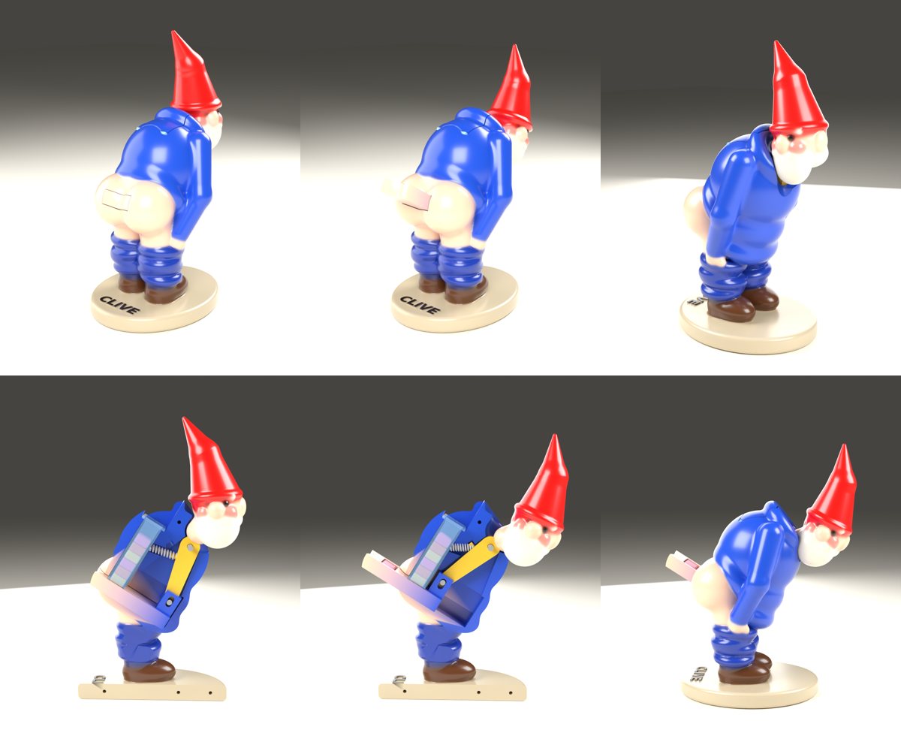

# Clive, the Cheeky Candy Dispenser

*He's naughty but nice.* Push Clive's head forward and a sweet pops out of his bum.



A printable, mechanical novelty candy dispenser in the spirit of a certain
famous brick-candy dispenser, but with a mooning garden gnome. Designed for
**Pez-style bricks** and **Tic Tacs**, and adjustable for any small, flat sweet.

> ## ⚠️ Never printed. Never tested.
> This model was designed entirely in software. Every part, clearance and
> motion was checked in a virtual test (see below), but **no one has printed
> it yet**. Expect to tune a tolerance or two. If you get it working, please
> share your print, your fixes and your settings. That's half the fun.

## How it works

1. Candies stack in a hopper tube inside Clive's back.
2. The bottom candy drops into a pocket in a sliding tray at his hips.
3. Clive's head is glued to a lever that pivots on an axle in his chest.
   Tip his head forward about 33° and the lever's leg swings back, pushing
   the tray **18 mm out through a hatch in his bum** with one candy on it.
   The tray blocks the hopper while it's out, so only one candy comes out.
4. Let go and a small spring (a ballpoint-pen spring works) pulls everything
   back. The next candy drops into the pocket.

## Parts to print

| File | Qty | Notes |
|---|---|---|
| `body_left.stl`, `body_right.stl` | 1 each | Print flat on the cut face. Tree supports only under the arms and legs. |
| `head.stl` | 1 | Hat up. Supports under the beard. |
| `lever.stl` | 1 | Flat. 100% infill (it's small and takes the load). |
| `tray_pez.stl` **or** `tray_tictac.stl` | 1 | Pocket facing up. |
| `hopper_pez.stl` **or** `hopper_tictac.stl` | 1 | Upright, flange down. Smooth bore matters most. |
| `refill_lid.stl` | 1 | Outer face up. |
| `axle_3mm_optional.stl`, `tray_pin_3mm_optional.stl` | 1 each | Only if you can't find 3 mm rod. |

Suggested settings: 0.12–0.16 mm layers, 3 perimeters, 15% infill, PLA or PETG.
Resin printers should handle it well. Leave the default clearances and sand
the sliding faces lightly.

## Hardware

- **Axle:** 22 mm of 3 mm rod, an M3 × 22 screw with its head cut off, or the printed axle.
- **Tray pin:** 12 mm of 3 mm rod, or the printed pin.
- **Spring:** about 4–4.5 mm outside diameter, 18–23 mm free length. Most clicky-pen springs fit; trim if needed.
- **Dowels:** four 12 mm pieces of 1.75 mm filament to line up the body halves.
- Glue: CA (superglue) for the head-to-lever joint and the body halves.

## Assembly

1. Push the axle through the lever's top hole. Seat one end in the left body half.
2. Put the pin through the lever's lower hole, then drop the tray in so the pin sits in the slots of the tray's two upright cheeks.
3. Put the spring on the peg on the back of the lever. Its other end goes into the pocket behind it.
4. Dry-fit the right half with the dowels. Rock the lever and check that the tray slides freely, **before gluing**.
5. Glue the halves, then glue the head onto the lever's post with the head upright.
6. Drop the hopper in from the back, flange up, so it hangs from its ledge. Fill it with candies **lying flat** and press on the lid.

## Food safety

FDM layer lines trap crumbs and bacteria, and most resins are not food-safe
when printed. Either use **wrapped** sweets, or print the tray and hopper in a
food-contact-rated filament and give them a food-safe coating. This is a novelty,
not a food-grade product.

## The virtual test

`src/build.py` rebuilds every part and then checks, numerically:

- each part is a single watertight solid;
- **no part collides with any other** at 12 steps through the full motion (lever, head, tray, pin, hopper, lid, body);
- the candy pocket ends up completely outside the body at full travel;
- no wall around the mechanism is thinner than 1.2 mm;
- each candy fits its hopper and **cannot flip onto its edge** inside it (that would jam the pocket);
- the spring stays within a sensible compression range.

Latest run: **25 of 25 checks passed** ([`report.json`](report.json)).

What the virtual test *can't* tell you: friction, print tolerances, how sticky
the candy is, or whether a slightly rough hopper bore jams. Those need a real print.

## Other candies

Edit the `CANDY` table in `src/params.py`: length, width and thickness of
*your* candy, measured with calipers. Rebuild, and the hopper bore and tray pocket
follow. The build refuses designs where the candy could tumble in the tube.
Anything up to about 15.6 × 8.6 × 5.5 mm fits the existing body.

## Rebuilding

```bash
pip install -r requirements.txt          # numpy, scikit-image, trimesh, manifold3d, bpy
python3 src/make_text.py assets/clive_text.stl   # nameplate lettering (needs bpy)
python3 src/build.py out --grid 0.45     # parts + checks (about 2 minutes)
python3 src/render_all.py out            # renders (Blender/Cycles, CPU)
```

The build writes to `out/` (ignored by Git). Copy `out/stl/*`, `out/renders/*`
and `out/report.json` over the published `stl/`, `renders/` and `report.json`
when you release a new version. `out/ply/` holds vertex-coloured meshes that
open straight in Blender, posed at rest and fully open.

On Windows use `py` in place of `python3`. The lettering script looks for
DejaVu Sans Bold at a Linux path and falls back to Blender's built-in font.

The sculpt is made of signed distance fields (`src/gnome.py`). Everything
is plain code, so you can change his pose, belly or hat and rebuild.

## License

Public domain: [CC0 1.0](https://creativecommons.org/publicdomain/zero/1.0/).
Print it, change it, sell it. No attribution needed. The nameplate lettering
is generated from DejaVu Sans Bold, whose license permits this.

Not affiliated with, or endorsed by, any candy or dispenser brand. "Pez" and
"Tic Tac" are trademarks of their owners and are only used to describe
compatible candy sizes.
