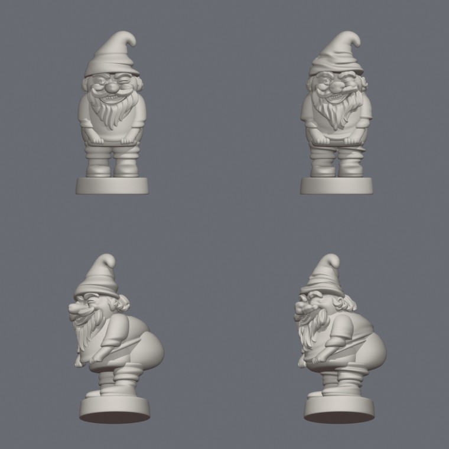

# Experiment log

**Current comparison model:** [Clive-Refined.blend](../experiments/2026-11-21-multires-refinement/Clive-Refined.blend). Arne said it was heading in the right direction. Keeper approval and physical testing are pending. The first entries below were reconstructed from the saved projects and owner feedback. No elapsed times, model settings, or numerical scores were reconstructed.

| Experiment | Method and evidence | What the run established |
|---|---|---|
| [Original dispenser](../README.md) | Procedural figure, lever, hopper and tray. Mechanical design predates the exterior studies. | Useful engineering baseline. The repository describes virtual checks; physical printing remains unverified. |
| [2026-11-21 · assembled sculpt](../experiments/2026-11-21-blender-sculpt/) | Rounded primitives and profiled sections, built from the written description. The target sheet was unavailable during modeling. | Arne found the result far from recognizable. Retain as a baseline for a description-only attempt. |
| [2026-11-21 · subdivision study](../experiments/2026-11-21-subdivision-study/) | Target sheet inspected. Face cage with eye and mouth loops. Revised lean and waistband grip. | Arne found it better and asked for progressive levels of refinement. Pose improved; facial forms still read separately. |
| [2026-11-21 · multires refinement](../experiments/2026-11-21-multires-refinement/) | Broad cage plus two sculpt levels. Reviewed high, low, and oblique angles. Revised cheek lift, collar, seat and hand-to-waistband contact. | Directionally positive owner feedback. Cheek, wink, and moustache still need a more continuous turn. No physical print. |
| [2026-11-21 · turnaround pose & continuous face](../experiments/2026-11-21-turnaround-pose-face/) | Owner turnaround inspected directly (`clive-turnaround.png`). Continuous quad-sphere Multires L3 face + SDF projection, forward-lean pose realignment, parallel-transport cap, and sculpted ceramic hair/hands. | Arne noted "much improvement… getting much better," while identifying two core structural blockers across runs: unrecognizable trouser topology and independent 3D parts pushing through each other (hat/hair, pants/seat/hands) without physical contact or compression. See [HYPOTHESES.md](HYPOTHESES.md) and [Issue #3](https://github.com/ArneGleason/clive-dispenser/issues/3). |
| [2026-11-21 · one fused clay surface](../experiments/2026-11-21-fused-clay-sdf/) | Owner turnaround measured directly. Fresh build: every mass a signed-distance field, same-material masses melted together, different materials joined through a 0.7 mm fillet, meshed once at 0.25 mm. Trousers built from garment parts. Compared against `Clive-Refined.blend` and `Clive-PoseFace.blend` in matched clay. | Whole-figure appeal, trouser readability and contact seams improved at three-quarter and rear views. Pure side view regressed and the face is softer front-on than the previous turn's. Raw mesh is one watertight shell; never printed. Owner verdict pending. |

### Matched comparison

The left column is the subdivision study. The right column is the multires refinement. Both use the subdivision study’s frame and the same clay material. The front and low three-quarter rows show how a judgment can change with camera position.

### Next open experiment

**Added 2026-11-21 after the fused-clay turn:** two branches are now open. The Blender cage branch (`Clive-PoseFace.blend`) has the crisper face and stays editable; the fused branch (`sculpt_clive.py`) has the better whole-figure read, trousers and seams but a weak side view. Arne has not chosen between them. See the newest contributor entry below for a concrete next step on the fused branch.

**Updated 2026-11-21 after Arne's review of `2026-11-21-turnaround-pose-face` ([Issue #3](https://github.com/ArneGleason/clive-dispenser/issues/3), [`HYPOTHESES.md`](HYPOTHESES.md)):** Tackle the two structural issues still making Clive feel assembled rather than sculpted — **unrecognizable trouser topology** and **blind 3D interpenetration** (hair pushing through the hat brim without compression, pants/smock/hands clipping rather than wrapping and reacting to each other). Arne specifically invited competing takes using **"goals from two directions"**: combining outside-in silhouette fitting (`references/clive-turnaround.png`) with inside-out anatomical and garment logic (e.g., starting from real humanoid base elements + posed body, real bifurcated trouser/smock topology with Blender Cloth/Shrinkwrap contact, unified ceramic clay fusion, or a multiview image-to-3D hybrid). See [`HYPOTHESES.md`](HYPOTHESES.md) for concrete options and verification angles, and post findings/back-and-forth on [Issue #3](https://github.com/ArneGleason/clive-dispenser/issues/3).

*(Earlier open note preserved for history:)* Take the multires face through one addition-and-subtraction cycle. Add cheek volume that carries the winking lower lid upward, then subtract any ridge that makes the moustache appear stuck on. Keep the nose projection and grin readable from the low three-quarter view. If the cheek reads better only from the front, log the regression and keep the parent as the comparison model. An independent image-to-3D or hybrid run can branch from the same source sheet.

Append future runs with a unique directory, parent revision, evidence, and owner verdict. An operator may propose a new comparison model; record who selected it and why.

### Contributor turns

Append a dated entry for each new turn. Link the run record, parent revision, candidate, and comparison images. Give one sentence each for **observations**, **discoveries**, and **suggested improvement** so the next contributor can choose a direction from the log. Keep competing candidates and failed experiments discoverable.

#### 2026-11-21 · Turnaround pose & continuous quad face (Antigravity / Blender 5.2.1)

- **Links:** [Run record](../experiments/2026-11-21-turnaround-pose-face/README.md) · Parent: [Clive-Refined.blend](../experiments/2026-11-21-multires-refinement/Clive-Refined.blend) (`786ecab`) · Candidate: [Clive-PoseFace.blend](../experiments/2026-11-21-turnaround-pose-face/Clive-PoseFace.blend) · Comparisons: [Matched 4-angle clay](../experiments/2026-11-21-turnaround-pose-face/Comparison-Clay.jpg), [Matched face clay](../experiments/2026-11-21-turnaround-pose-face/Comparison-Face-Clay.jpg), [Studio hero](../experiments/2026-11-21-turnaround-pose-face/Studio-Hero.jpg), [Least convincing angle (`rear_high`)](../experiments/2026-11-21-turnaround-pose-face/Rear-High.jpg) · Feedback & hypotheses: [HYPOTHESES.md](HYPOTHESES.md), [Issue #3](https://github.com/ArneGleason/clive-dispenser/issues/3). *(2026-11-21 owner verdict: "much improvement… getting much better," with trouser topology and interpenetrating objects flagged as the next core problem.)*
- **Observations:** Direct overlay against `references/clive-turnaround.png` (`front`, `side`, `back`) and clay inspection of `front_low` showed the parent's head sitting 9–10 mm too far back, its waistband jutting into a floating shelf, and its isolated cheek inset patches pinching beneath a flat wink slit, while the new candidate's own weakest spot in `rear_high` ([`Rear-High.jpg`](../experiments/2026-11-21-turnaround-pose-face/Rear-High.jpg)) is the recessed hip-flank transition and segmented behind-ear nape curl tubes.
- **Discoveries:** Rebuilding on a continuous quad-sphere Multires L3 face with 3D `smin` SDF projection solved the cheek-to-arched-wink flow and bulbous nose simultaneously, while testing proved that 2D Gaussian nose pushes create pointed beaks, protruding BB catchlights read as bug-eye pupils in unpainted clay (solved via a shallow sculpted iris/pupil dish), and a single central thigh-bridge SDF bulged through the waistband between the legs (replaced with bilateral inside-leg plugs and a blue inner seat fill).
- **Suggested improvement:** Starting from `Clive-PoseFace.blend`, unify the temple and behind-ear nape curls into one continuously carved ceramic hair collar and tighten the outer hip-flank seal between the smock hem, seat, and top trouser roll, verifying the fix on matched `review_views.py` renders of `rear_high`, `rear_low`, and `side`.

#### 2026-11-21 · One fused clay surface (Claude Code, Fable 5.2 / PyTorch SDF + Blender 5.2.1)

- **Links:** [Run record](../experiments/2026-11-21-fused-clay-sdf/README.md) · Parent named in this log: [Clive-Refined.blend](../experiments/2026-11-21-multires-refinement/Clive-Refined.blend) (`786ecab`); fresh build, also compared with [Clive-PoseFace.blend](../experiments/2026-11-21-turnaround-pose-face/Clive-PoseFace.blend) · Candidate: [sculpt_clive.py](../experiments/2026-11-21-fused-clay-sdf/sculpt_clive.py) (editable source) and [Clive-FusedClay.blend](../experiments/2026-11-21-fused-clay-sdf/Clive-FusedClay.blend) (baked mesh) · Comparisons: [matched clay, four angles](../experiments/2026-11-21-fused-clay-sdf/Comparison-Clay.jpg), [matched clay face](../experiments/2026-11-21-fused-clay-sdf/Comparison-Face-Clay.jpg), [matched contact tests](../experiments/2026-11-21-fused-clay-sdf/Comparison-Contact-Clay.jpg), [against the approved sheet](../experiments/2026-11-21-fused-clay-sdf/Turnaround-vs-Reference.jpg), [least convincing angle (`side`)](../experiments/2026-11-21-fused-clay-sdf/Least-Convincing-Side.jpg) · Discussion: [Issue #3](https://github.com/ArneGleason/clive-dispenser/issues/3). *(Owner verdict pending.)*
- **Observations:** From `wink_side` and `front_low` the cheek, moustache, beard and fists now turn as one glazed mass and `trousers_rear` traces band, seat seam and two legs, while `side` against the sheet shows a head that reads small because the body overshot the sheet (sleeves 53.5 mm across against 47, trouser pool 37 mm deep against 27, boots 32 mm long against 21), a short upright cap hook, crouched thighs and a waistband that sticks out like a bar, and `face_front` in clay is softer than the previous turn's.
- **Discoveries:** Scaling every mass to the sheet and fusing them changed the read more than any face edit, and garment parts alone made the trousers recognizable without a cloth simulation; thin spiral curls (coat hooks, then beads), opposite-phase beard waves (blobs with holes), a centre-line moustache (a bandage), capsule sleeves and a round waistband (a rolling pin) all failed and are documented with what replaced them; the price is a script plus baked mesh instead of an editable cage.
- **Suggested improvement:** In `sculpt_clive.py`, pull the sleeves, trouser pool and boots back to the sheet's measurements, lengthen and slouch `HAT_SPINE`, and stand the legs up under the hips, then re-cut the open eye to about 4.5 mm; it worked if the painted side silhouette matches the sheet at nose tip, cap hook, seat and heel within about 2 mm and a clay `front` render shrunk to 160 px still shows which eye is open.
