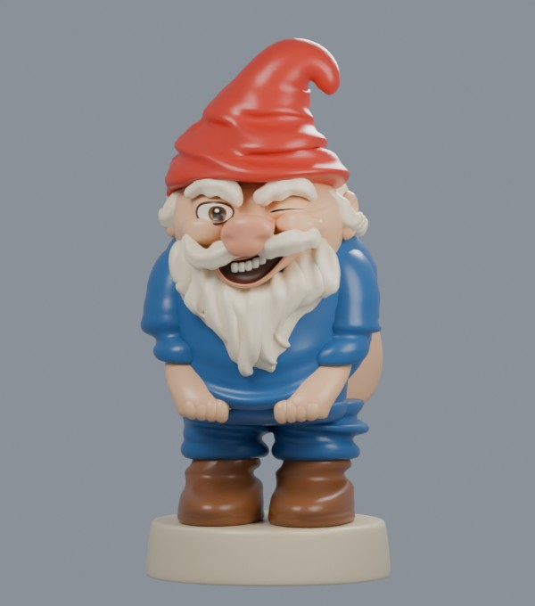

# Clive · Sculpt history

[Approved reference image](../references/clive-turnaround.png) · [Browse the latest sculpt](multires-1.md) · [Start with the original dispenser](original-1.md) · [Copy the current agent prompt](../HANDOFF.txt)

| Experiment | Progress |
|---|---|
| [Original dispenser](original-1.md) | Virtual assembly and motion checks established a mechanical starting point. A physical print is still pending. |
| [Assembled sculpt](assembled-1.md) | Arne found the likeness too distant. This run gives later experiments a description-only baseline. |
| [Subdivision study](subdivision-1.md) | The silhouette improved. The cheek, wink, and moustache still read as separate forms, especially from below. |
| [Multires refinement](multires-1.md) | Arne felt the sculpt was heading in the right direction. The next experiment is to carry the cheek into the winking eyelid, then soften the ridge beneath the moustache. |

[Full experiment log](../LOG.md) · [Current handoff prompt](../HANDOFF.txt)

For the standalone interactive version, serve the repository root locally and open `/character-sculpt/gallery/index.html`. The gallery above works directly on GitHub.
