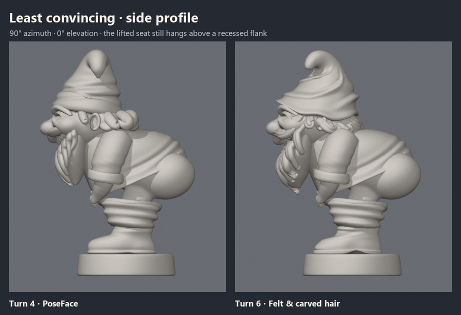

# Felt and carved hair

[History](README.md) · [Agent prompt](../HANDOFF.txt) · [Experiment log](../LOG.md) · [Run record](../../experiments/2026-11-21-felt-and-carved-hair/README.md)

[← Previous](feltcarved-2.md)　3 of 7 · Least convincing · matched side profile　[Next →](feltcarved-4.md)

**November 21, 2026 · GPT-6.2 Sol (extra high) in Codex desktop · Blender 5.2.1**

Started from Neon’s PoseFace. A flared felt brim turns over the brows and ears, diagonal folds climb toward the hook, and carved locks swing back under the chin. Buckled boots have a defined welt and heel.

The high rear three-quarter shows the strongest improvement. The side profile still exposes the recessed flank between the raised seat and the lowered trousers. Owner verdict pending.

[Original dispenser](original-1.md) · [Assembled sculpt](assembled-1.md) · [Subdivision study](subdivision-1.md) · [Multires refinement](multires-1.md) · [Turnaround pose & continuous face](poseface-1.md) · [One fused clay surface](fusedclay-1.md) · [Felt and carved hair](feltcarved-1.md)
