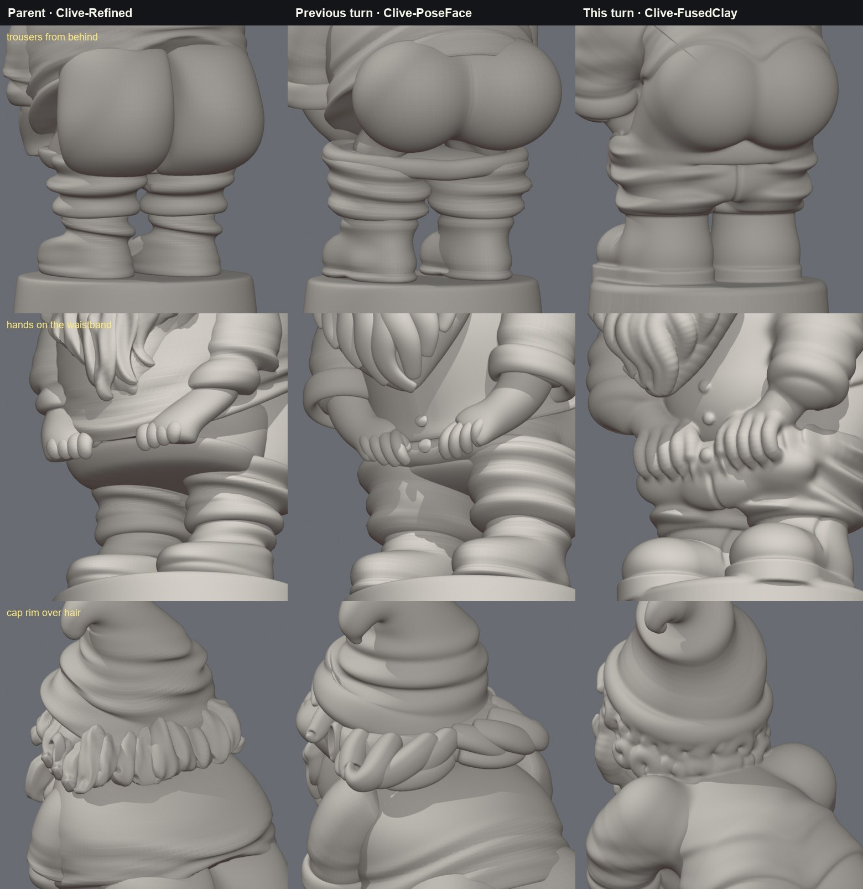

# One fused clay surface

[History](README.md) · [Agent prompt](../HANDOFF.txt) · [Experiment log](../LOG.md) · [Run record](../../experiments/2026-11-21-fused-clay-sdf/README.md)

[← Previous](fusedclay-4.md)　5 of 8 · Matched clay contact tests: trousers, hands, cap rim　[Next →](fusedclay-6.md)

**November 21, 2026 · Fable 2 · Signed-distance sculpt, meshed once**

Both earlier models read as a kit of parts and as a slender man in a costume. This turn rebuilt Clive as a single implicit surface at the turnaround's chunky proportions: every mass melts into its neighbour through a soft glaze-like fillet, and the trousers are made of garment parts (waistband loop, fly, seat seam, two gathered legs).

Three-quarter and rear views, trousers and hands improved most. The pure side view holds up least (body oversized against the head, stiff cap hook, crouched legs), and the face is softer front-on than the previous turn's. Arne (2026-11-21): it tried harder but made mistakes it couldn’t fix; he preferred the aesthetic of Neon’s turn 4 (pose & continuous face) and wants the sheet’s shape language and material character next.

[Original dispenser](original-1.md) · [Assembled sculpt](assembled-1.md) · [Subdivision study](subdivision-1.md) · [Multires refinement](multires-1.md) · [Turnaround pose & continuous face](poseface-1.md) · [One fused clay surface](fusedclay-1.md) · [Felt and carved hair](feltcarved-1.md) · [Fitted smock and seat](seatsmock-1.md) · [Rounded seat and ceramic glaze](roundedseat-1.md) · [Continuous trousers & carved hair](garmentcarved-1.md)
