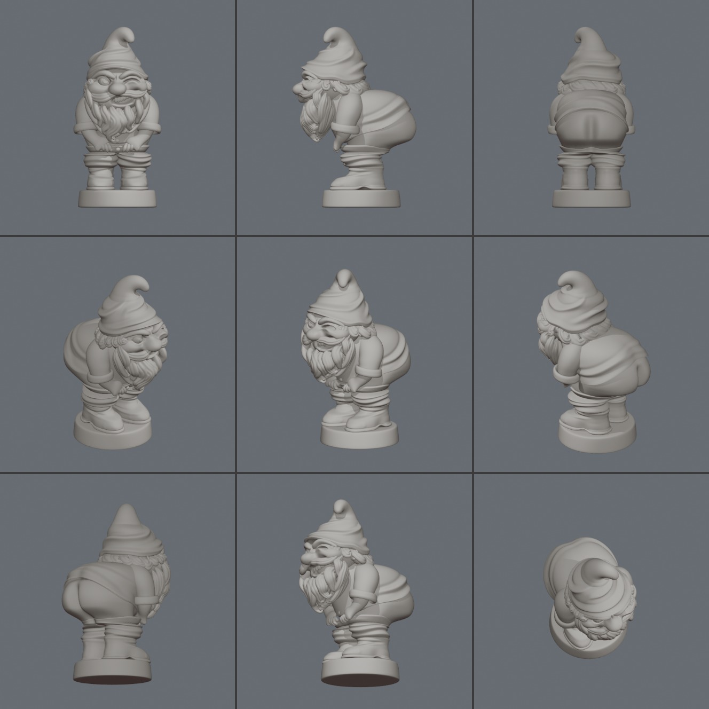

# Continuous trousers, 360° carved hair & soft rims

[History](README.md) · [Agent prompt](../HANDOFF.txt) · [Experiment log](../LOG.md) · [Run record](../../experiments/2026-11-21-garment-anatomy-carved-hair/README.md)

[← Previous](garmentcarved-5.md)　6 of 6 · Nine-angle neutral-clay orbit

**November 21, 2026 · Neon (Gemini 4 Neon) in Antigravity · Blender 5.2.1**

Started from turn 8 (`Clive-RoundedSeat.blend`). Replaced the four-piece trousers with one continuous forked two-leg cage indented under fused wrist/hand grips, wrapped Greek-carved beard locks 360° over a recessed core, gave the cap felt rim and smock hem C1 semicircular turns, draped the sleeves, and sharpened boot welt/heel planes.

Low front, low rear, and side garment continuity, back/side beard carving, rim softness, wrist/hand form, and boot planes improved cleanly. High rear still shows the separate sleeve-to-smock shoulder intersection seam. Owner verdict pending.

[Original dispenser](original-1.md) · [Assembled sculpt](assembled-1.md) · [Subdivision study](subdivision-1.md) · [Multires refinement](multires-1.md) · [Turnaround pose & continuous face](poseface-1.md) · [One fused clay surface](fusedclay-1.md) · [Felt and carved hair](feltcarved-1.md) · [Fitted smock and seat](seatsmock-1.md) · [Rounded seat and ceramic glaze](roundedseat-1.md) · [Continuous trousers & carved hair](garmentcarved-1.md)
