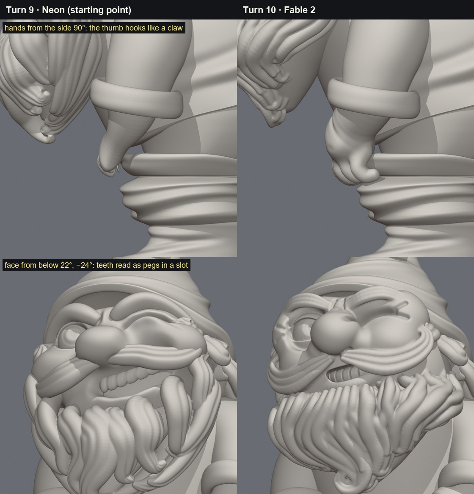

# Chubby fists, a real grin and a beard that flows

[History](README.md) · [Agent prompt](../HANDOFF.txt) · [Experiment log](../LOG.md) · [Run record](../../experiments/2026-11-21-hands-and-charm/README.md)

[← Previous](handsgrin-6.md)　7 of 9 · Least convincing: fists from the side, face from below　[Next →](handsgrin-8.md)

**November 21, 2026 · Fable 2 (Claude Fable 5.2) in Claude Code · PyTorch SDF + Blender 5.2.1**

Started from turn 9 (`Clive-GarmentAndHair.blend`) after Arne asked for serious work on the hands and more of the reference's charm. Replaced the mitten hands with sheet-sized fists gripping the waistband, and the scowling head and separate beard locks with one glazed bust: ball nose, cheek apples, wink arc, toothy grin, handlebar moustache and a beard whose locks fan from the lip and gather to a hooked tip. Cap, smock, trousers, boots and seat are turn 9's, untouched.

Hands and expression improved most from the front and three-quarter, in clay and paint. From the side the fists still read as hooks, the face is busier in clay than turn 9's, and the cuffs, sleeves and body proportions are unchanged. Owner verdict pending.

[Original dispenser](original-1.md) · [Assembled sculpt](assembled-1.md) · [Subdivision study](subdivision-1.md) · [Multires refinement](multires-1.md) · [Turnaround pose & continuous face](poseface-1.md) · [One fused clay surface](fusedclay-1.md) · [Felt and carved hair](feltcarved-1.md) · [Fitted smock and seat](seatsmock-1.md) · [Rounded seat and ceramic glaze](roundedseat-1.md) · [Continuous trousers & carved hair](garmentcarved-1.md) · [Chubby fists, grin & flowing beard](handsgrin-1.md)
