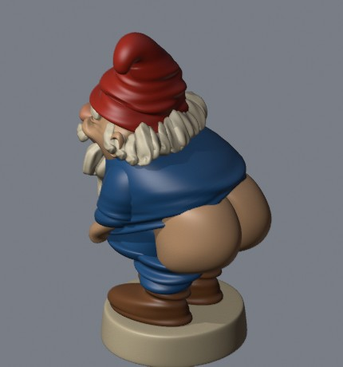

# Multires refinement

[History](README.md) · [Agent prompt](../HANDOFF.txt) · [Experiment log](../LOG.md)

[← Previous](multires-2.md)　3 of 5 · Elevated rear view　[Next →](multires-4.md)

**November 21, 2026 · Multiresolution sculpting**

Two sculpt levels built up the cheek, collar, and cloth folds. Oblique views exposed a gap between the hands and waistband, which this pass reduced.

Arne felt the sculpt was heading in the right direction. The next experiment is to carry the cheek into the winking eyelid, then soften the ridge beneath the moustache.

[Original dispenser](original-1.md) · [Assembled sculpt](assembled-1.md) · [Subdivision study](subdivision-1.md) · [Multires refinement](multires-1.md) · [Turnaround pose & continuous face](poseface-1.md) · [One fused clay surface](fusedclay-1.md) · [Felt and carved hair](feltcarved-1.md) · [Fitted smock and seat](seatsmock-1.md) · [Rounded seat and ceramic glaze](roundedseat-1.md) · [Continuous trousers & carved hair](garmentcarved-1.md) · [Chubby fists, grin & flowing beard](handsgrin-1.md)
