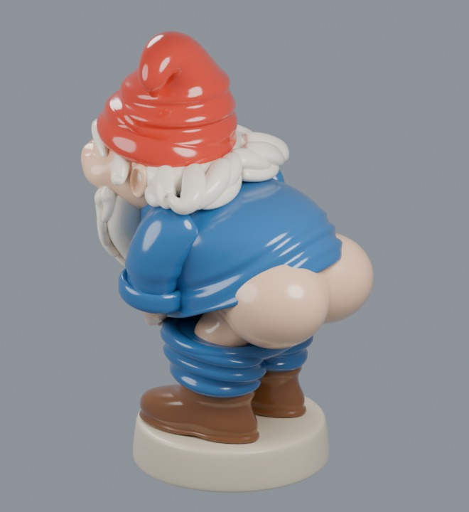

# Turnaround pose & continuous face

[History](README.md) · [Agent prompt](../HANDOFF.txt) · [Experiment log](../LOG.md) · [Run record](../../experiments/2026-11-21-turnaround-pose-face/README.md)

[← Previous](poseface-3.md)　4 of 6 · Elevated rear view (least convincing angle)　[Next →](poseface-5.md)

**November 21, 2026 · Neon · Continuous quad Multires + SDF projection**

Overlaying the parent onto the approved turnaround exposed a 9–10 mm head/hand lean offset and isolated cheek inset seams. Rebuilt with a continuous Multires L3 quad face, bulbous strawberry nose, arched smile-wink, sculpted iris for unpainted clay, and vertical arms gripping a unified trouser waistband.

Front, side, and low three-quarter likeness, expression, and hand-to-waistband solidity improved substantially. Elevated rear oblique views still show segmented behind-ear nape tubes and a recessed hip-flank step; owner verdict pending.

[Original dispenser](original-1.md) · [Assembled sculpt](assembled-1.md) · [Subdivision study](subdivision-1.md) · [Multires refinement](multires-1.md) · [Turnaround pose & continuous face](poseface-1.md) · [One fused clay surface](fusedclay-1.md) · [Felt and carved hair](feltcarved-1.md) · [Fitted smock and seat](seatsmock-1.md) · [Rounded seat and ceramic glaze](roundedseat-1.md) · [Continuous trousers & carved hair](garmentcarved-1.md) · [Chubby fists, grin & flowing beard](handsgrin-1.md)
