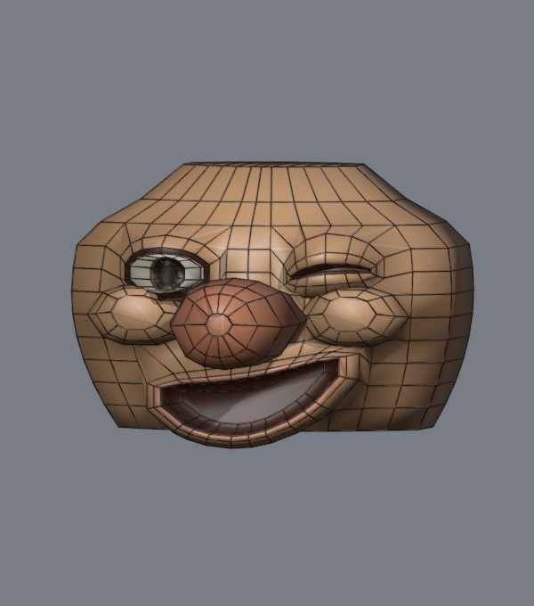

# Subdivision study

[History](README.md) · [Agent prompt](../HANDOFF.txt) · [Experiment log](../LOG.md)

[← Previous](subdivision-2.md)　3 of 3 · Facial control cage　[Next →](multires-1.md)

**November 21, 2026 · Box modeling**

The turnaround guided the forward lean and waistband grip. Editable loops shaped the eyelids, nose, and grin.

The silhouette improved. The cheek, wink, and moustache still read as separate forms, especially from below.

[Original dispenser](original-1.md) · [Assembled sculpt](assembled-1.md) · [Subdivision study](subdivision-1.md) · [Multires refinement](multires-1.md) · [Turnaround pose & continuous face](poseface-1.md)
