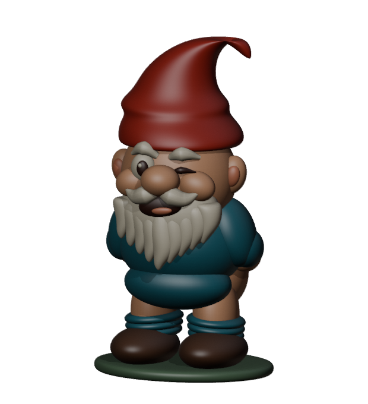
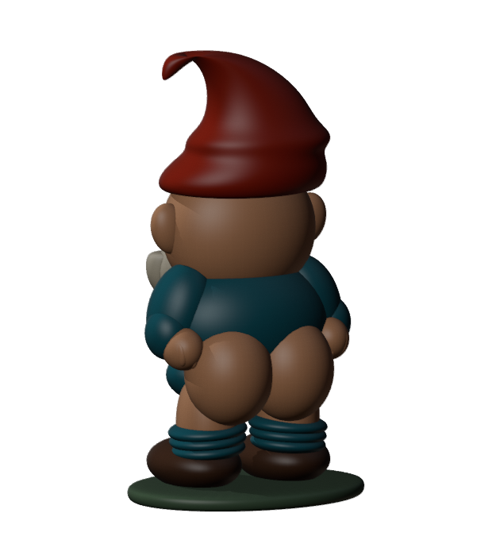

# Clive sculpt study · November 21, 2026

A visual baseline for the mooning-gnome dispenser. The goal is a figurine someone would choose to print for the character alone. This pass missed the likeness. It was built from a written description because the turnaround image was unavailable during modeling.




## Inspect or rebuild

Open `Clive.blend` to inspect the separate forms. In a fresh output directory, run the following with Blender 5.2.1 and the path to this script. The script writes Clive.blend, Front.png, Rear.png and Clive.stl into the current directory.

```sh
blender --background --python /path/to/sculpt.py
```

The static sculpt is about 103 mm tall. The STL export uses a 0.32 mm voxel remesh. Blender reported zero non-manifold edges in the export pass. Physical printability and fine detail remain untested.

## Next comparison

Use the approved front, side and back turnaround as the visual target. Try a multiview image-to-3D base, then refine the grin, wink, beard flow and forward lean in Blender. Render both candidates at the same height and camera angles, including a side profile and a single-color clay view. Judge recognition and the mooning pose before evaluating a test print. Record the inputs, tool, settings, manual edits and elapsed time with each candidate.

The original dispenser elsewhere in the repository supplies a separate mechanical reference. Its tipped-head lever and sliding tray can be evaluated once a sculpt is approved.
