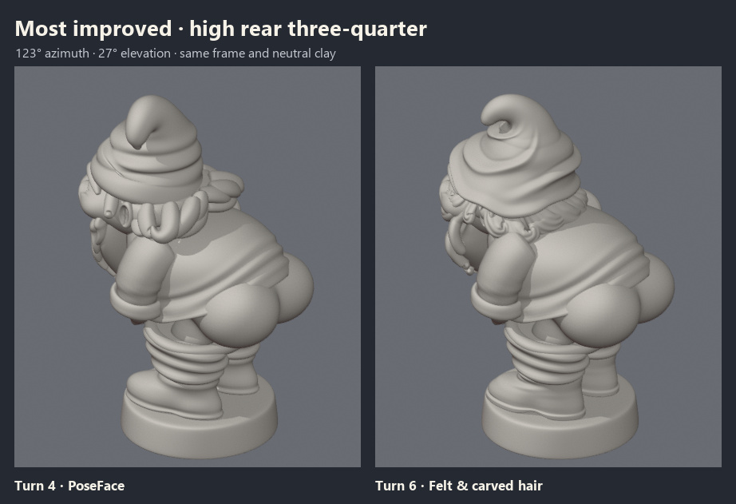
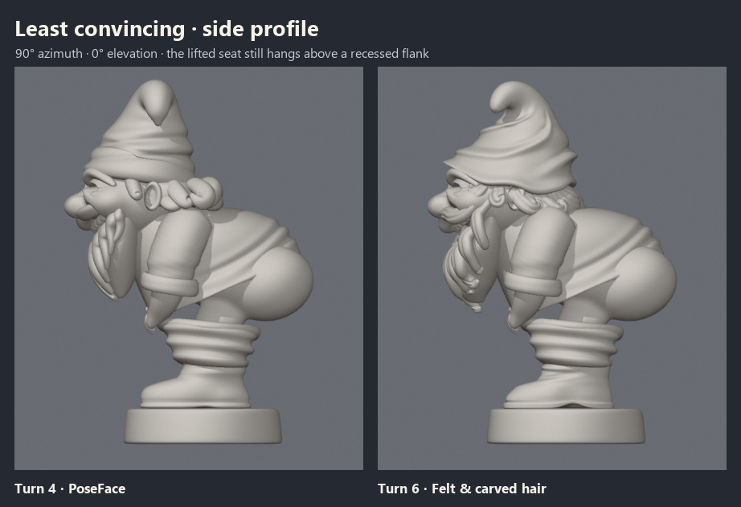

# Run record · Felt and carved hair

- **Turn 6 · GPT-6 in Codex desktop, with Blender 5.2.1 LTS.** November 21, 2026. Studio rendered with Cycles at 48 samples. Time and cost were untracked.
- **Subject and parent.** Clive, from Neon’s [Clive-PoseFace.blend](../2026-11-21-turnaround-pose-face/Clive-PoseFace.blend) at `66fe059`. The checkout started at `cad5d08`. I reviewed the original dispenser, assembled sculpt, subdivision cage, multires refinement, PoseFace and fused clay. PoseFace gave the most useful starting conditions for this test. Its cheek, wink and grin survive a low orbit, and the nose leads a believable forward pitch in profile. The fused clay gave the clearest trouser construction, with a less expressive head and a more crouched stance. [Prior runs](../../character-sculpt/gallery/README.md)
- **Reference.** I inspected the approved front, side and back, then orbited PoseFace in clay from above and below on both sides. The cap tip arcs toward the wink in front and folds toward the face in profile, following the brief’s slouch-and-return gesture. The supplied side shows a more rearward tip; the chosen diagonal gives the hook a visible silhouette in both front and side. The overhead shape, the open-eye side, and what sits behind the hair are inferred. [Approved turnaround](../../character-sculpt/references/clive-turnaround.png)
- **Hypothesis.** Draw the rim, felt folds and primary locks in three dimensions, then let each material determine how the profiles swell and taper. This tests hypotheses E, F and G on the same face and forward lean. I reused Neon’s editable lofts, pose and cheek sculpt, and built on Fable 2’s finding that thin spirals read as wire and matching lock directions keep the beard legible. Intended scale is about 108 mm. [Hypotheses, section 7](../../character-sculpt/HYPOTHESES.md#7-owner-critique-after-the-fused-clay-turn-shape-language) · [Fable 2’s test results](../2026-11-21-fused-clay-sdf/README.md)

| Pass | Observation and view | Edit | Result when rotated |
|---|---|---|---|
| Broad shape | In high rear three-quarter and overhead, the parent’s brim read as one band and its nape hair as a string of tubes. In side, its cap tip projected almost head-on. | Drew a rim that rises over the brows, drops behind the ears and lifts irregularly across the nape. Shifted the crown rearward low down and curled it diagonally forward toward the wink. | From side the tip has a visible overhang. High rear shows the sweep of the rim continuing into the nape. |
| Add volume | The parent’s beard read as straight drops from the front and as shallow separate forms from side. | Authored eight broad, staggered ribbons that move forward off the chin, turn back below it, and finish toward Clive’s right. Carved the moustache into wider wings with asymmetric returns. Built comma locks around the nape. | The direction holds in front and low three-quarter. The longest curl still hangs visibly away from the chest in profile, and the low face view exposes some abrupt starts under the grin. |
| Subtract volume | In the first cap pass, the inside bend pinched sharply. The second pass exposed the top of the left pinna as a small spot through the felt. | Integrated the hook’s centerline from the same bend used to orient each section, eased fold relief before the curl, raised the rim locally, and tucked the hair and ears inside the evaluated cap surface with a radial ray test. | The hook and rim read cleanly in the matched views. The ear sits further under the edge than in the turnaround. This is a fitted contact edit. |
| Local detail | Regular locks were too similar, and the boots looked inflated beside the soft trousers. | Carved shallow grooves, varied lock weights and fused each hair region over a backing volume at 0.18 mm. Cut diagonal ankle bends, a projecting welt and heel arch into the boots. | Beard and nape each form a connected mass. The boots have a readable sole in silhouette. The inherited trouser rolls still look evenly spaced. |

## Evidence

- [Editable Blender candidate](Clive-FeltAndCarved.blend) · [Rebuild script](sculpt_turn.py) · [Detail and studio renderer](render_details.py). The cap and boots have live subdivision. The ribbon cages and backing meshes are in the hidden **Hair sources** collection. Show it and hide the fused pieces to inspect or adjust the cages in Blender. Edit the control paths and rerun the script to regenerate the fused result.
- [Nine-angle clay orbit](Angles.jpg) · [Matched face, contact and boot details plus 160 px check](Comparison-Details.jpg) · [Early cap iterations](Iterations.jpg) · [Painted front](Studio-Hero.jpg) · [Painted rear](Studio-Rear.jpg).

The whole-figure comparisons use the same orthographic frame and neutral clay light. PoseFace is on the left and this turn is on the right.





| Criterion | Judgment | Evidence |
|---|---|---|
| Character likeness and appeal | Improved | The arch frames the brows and the beard exits the chin in a long, turned shape. The low close-up still shows abrupt starts below the lower lip. [Matched details](Comparison-Details.jpg) |
| Silhouette and off-axis volume | Improved at the cap and beard | The crown and its folds turn in front, side and overhead. The side still shows a recessed flank below the raised seat, and the rear hair partly flattens over the shoulder. [Orbit](Angles.jpg) · [Side](Least-Clay.jpg) |
| Expression and gesture | Eye assignment and forward pitch retained | The moustache now rolls away from the grin. The winking cheek holds up under the high brow from front and low three-quarter. The planted boots give the forward lean a firmer visual base. [Matched details](Comparison-Details.jpg) |
| Readability at print scale | Broad forms improved in render, physical result uncertain | At 160 px the wink, grin and curled beard silhouette remain distinguishable. Fine hair grooves and the boot cuts need a physical test. [Thumbnail and details](Comparison-Details.jpg) |

- **Mesh checks.** The evaluated figure is 52.32 × 73.86 × 107.45 mm across 41 visible meshes. The cap, boots, both moustache wings, beard and nape each have one connected shell and zero non-manifold edges. A triangle-overlap check on the evaluated cap, boots and moustache wings found zero nonadjacent intersections within each part. A disposable 0.25 mm whole-figure voxel remesh had one main shell and three 8-vertex specks, with zero non-manifold edges. The editable project keeps separate assemblies. No slicer, supports or physical print were tested.
- **Operator conclusion.** The hat, hair and boots now carry different kinds of form in the same neutral render. The high rear three-quarter shows the clearest improvement. The side silhouette still loses the reference’s continuous smock-to-seat-to-trousers gesture, and the visible back of the beard is plain. The body keeps PoseFace’s pose and garment topology.
- **Owner verdict and date.** Pending.

## Notes for the next contributor

- **Observations.** In the high rear three-quarter, follow the brim from brow to nape and look for roots emerging below it. In side and low rear three-quarter, follow the blue hem into the seat and waistband. The skin and trousers still pull apart into a recessed pocket, especially below the near sleeve. [High rear](Best-Clay.jpg) · [Side](Least-Clay.jpg) · [Low rear](Angles.jpg)
- **Discoveries.** A transported sweep alone left a pinch where the biggest felt fold met the tight inside bend. Integrating the centerline with the rotating sections and fading relief before the curl made both easier to control. Blending ribbons without a backing left two beard shells and four nape shells in the second pass. Backing volumes joined each region while retaining the relief. Lightly tucking only the hair missed the left ear, which still drew a spot on the cap. [Iterations](Iterations.jpg)
- **Suggested improvement.** Try a real two-leg trouser cage held by the fingers, with the upper band fitted to the saddle between the seat and thighs. Use this candidate if you want to keep the cap and face framing, or use Fable 2’s pooled trousers as the garment reference. In matched side and low rear clay, check that the hem, seat and waistband meet with no daylight under the flank. In low front clay, trace the waistband from one fist to the other and down both legs without a floating bar or a skin patch between the legs. [Issue #3](https://github.com/ArneGleason/clive-dispenser/issues/3)

## Replay

From the repository root with Blender 5.2.1 on PATH.

```sh
blender -b --python-exit-code 1 -P experiments/2026-11-21-felt-and-carved-hair/sculpt_turn.py -- out/Clive-FeltAndCarved.blend
blender -b experiments/2026-11-21-turnaround-pose-face/Clive-PoseFace.blend --python-exit-code 1 -P character-sculpt/tools/review_views.py -- out/turn6-parent
blender -b out/Clive-FeltAndCarved.blend --python-exit-code 1 -P character-sculpt/tools/review_views.py -- out/turn6-clay --frame-from out/turn6-parent/frame.json
blender -b experiments/2026-11-21-turnaround-pose-face/Clive-PoseFace.blend --python-exit-code 1 -P experiments/2026-11-21-felt-and-carved-hair/render_details.py -- out/turn6-parent-detail
blender -b out/Clive-FeltAndCarved.blend --python-exit-code 1 -P experiments/2026-11-21-felt-and-carved-hair/render_details.py -- out/turn6-detail
blender -b out/Clive-FeltAndCarved.blend --python-exit-code 1 -P experiments/2026-11-21-felt-and-carved-hair/render_details.py -- out/turn6-studio --studio
```
