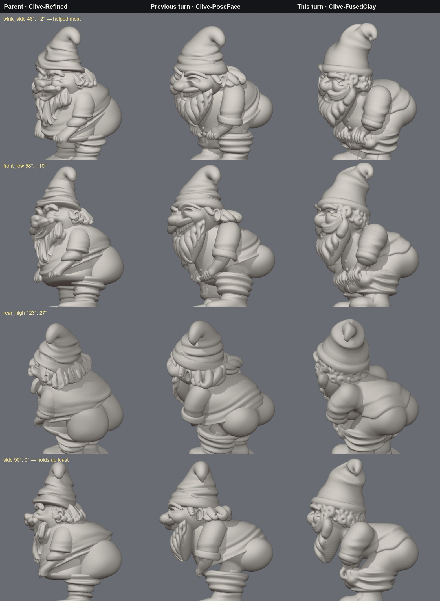
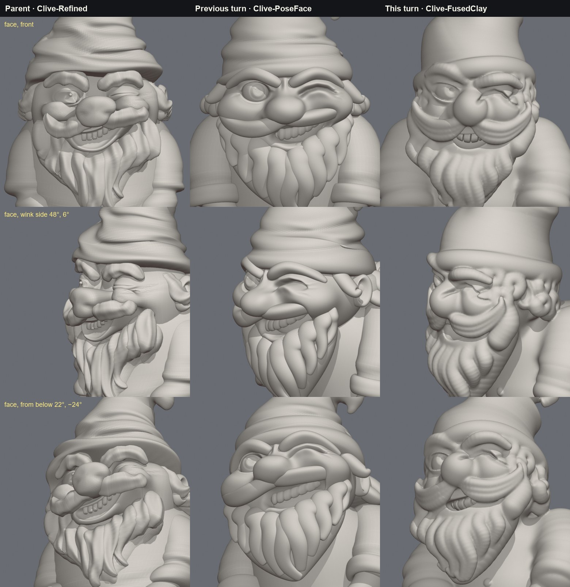
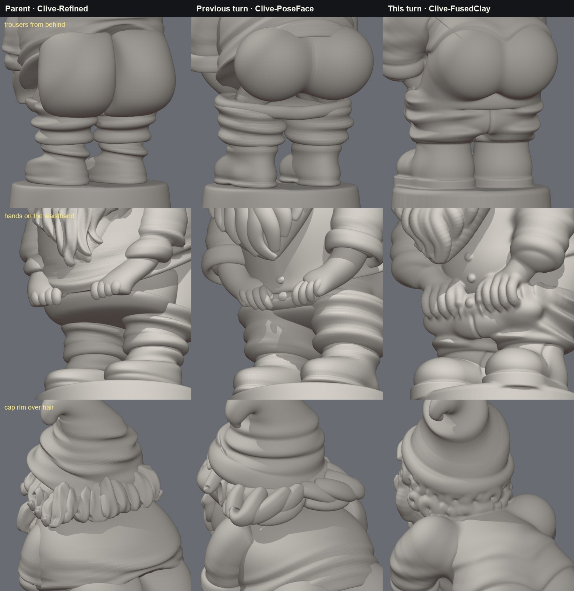
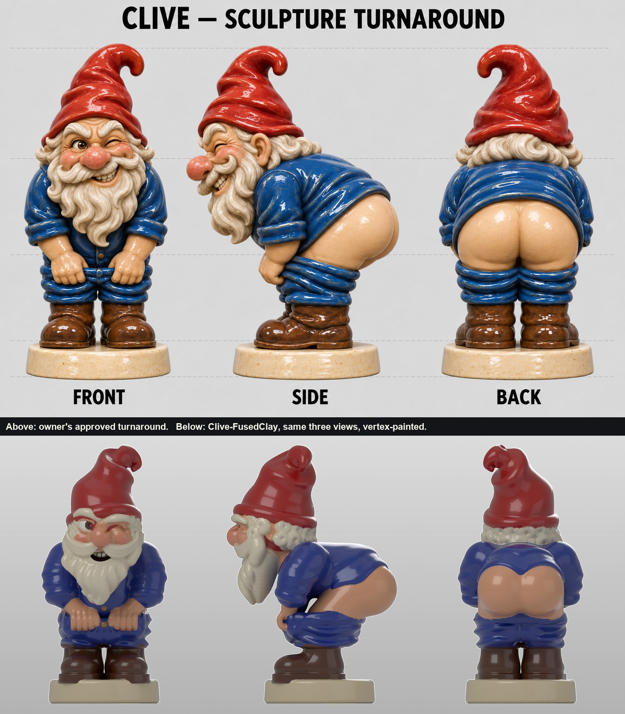
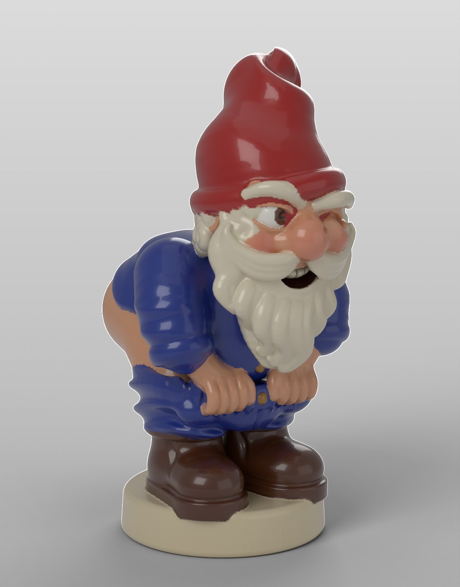

# Run record · One fused clay surface, chunkier proportions

- **Date, operator/model, tool/version, time and cost:** 2026-11-21 · Claude Code (Claude Fable 5.2) · Python 3.12 with PyTorch 2.6 (CUDA), scikit-image 0.26 marching cubes, Blender 5.2.1 LTS for review and paint renders. One session, seven sculpt passes; a full 0.25 mm rebuild takes about 8 seconds on an RTX 4080 SUPER. Cost not recorded.
- **Subject, parent path and commit:** Clive ([brief](../../character-sculpt/subjects/clive.md)). Comparison model named in the log: [`Clive-Refined.blend`](../2026-11-21-multires-refinement/Clive-Refined.blend) (`786ecab`). Repository `HEAD` at start: `79e8950`. This is a **fresh build**, not an edit of the parent; the previous turn's [`Clive-PoseFace.blend`](../2026-11-21-turnaround-pose-face/Clive-PoseFace.blend) is shown beside both because its measurements and critique shaped this one.
- **Reference actually inspected:** the owner's [`clive-turnaround.png`](../../character-sculpt/references/clive-turnaround.png), front, side and back. Landmarks were measured off it at 0.1355 mm per pixel (108 mm overall). Overhead shape, underside, the open-eye profile and everything behind the beard are inferred. No image generator or image-to-3D model was used.
- **Hypothesis:** Orbiting both earlier models against the sheet, the largest gap was not a local feature. Clive read as a kit of parts (tubes, rings, shells meeting at knife edges) and as a slender man in a costume: head and cap small, limbs thin, boots small. So this turn took [Hypothesis C](../../character-sculpt/HYPOTHESES.md) (unified ceramic fusion) to its limit and challenged Hypothesis B's assumption that recognizable trousers need a cloth simulation.
- **Method:** every mass is a signed-distance field in millimetres ([`sculpt_clive.py`](sculpt_clive.py)). Masses of one material melt together with a wide smooth union; different materials meet through a 0.7 mm one, which leaves a soft glaze-like fillet at every seam. The whole figure is then meshed once, so nothing can pass through anything else. Trousers are built from garment parts (one waistband loop, fly panel, seat panel with centre seam, two gathered legs with a seam valley between them) rather than simulated. Intended print height 109.6 mm on a 47 mm plinth.
- **Should improve:** whole-figure appeal and proportion at three-quarter views, trouser readability, contact seams. **Preserve:** eye assignment (his right eye open, left winking), bare rear with no sign, plinth footprint, +Z up and facing −Y so `review_views.py` frames match.

| Pass | Observation and view | Edit or deliberate omission | Result when rotated |
|---|---|---|---|
| Broad shape | Parent and PoseFace against the sheet in `front` and `side`: head, cap, sleeves, boots all under-scaled; parts visibly separate in `rear_high`. | Rebuilt as one implicit surface from sheet landmarks: 32 mm cap over a 25 mm skull, 53 mm across the sleeves, nose 39 mm ahead of the plinth axis, seat 33 mm behind it. | First mesh read as a gnome from `rear` only. A sign error wrapped the hair curls across the face, sleeves read as sausages with a cuff ring, legs were thin columns. |
| Add volume | `side` showed daylight between belly, forearm and thigh; `rear` showed two ribbed leg tubes under a hoop. | Thighs from 7–8 mm to 9.4–10.3 mm radius, pooled trouser legs widened to 18.6 × 25 mm each, seat and fly panels added so the waistband is the rim of a garment, boots grown twice (final toe 7.8 mm radius, shaft 8.7 mm). Beard widened and lengthened 1.4 mm. | `trousers_rear` now traces band, seat seam, two legs. `side` still shows the band as a bar ahead of the fists. |
| Subtract volume | `face_front`: brows and moustache were 5–7 mm thick and buried the eyes; cheek sphere covered the lower half of the open eye. | Brows cut to single 1.2–1.7 mm locks, moustache parted under the nose and thinned, open-eye cheek dropped 1.7 mm, socket carved after the cheeks instead of before. Removed three small laugh lines the voxel size could not hold. | Open eye visible from `front`, `face_open34` and `face_low`. Wink arc reads from the wink side, weakly from dead front. |
| Local detail | Hair read as hooks, then as a pleated fringe with a bead row (`nape_high`). Cap folds were ridged. Eye read as a doughnut in clay and a bug eye in paint. | Hair rebuilt as fat ringlets in two staggered rows starting under the cap rim. Cap fold phase taken from a soft-weighted spine parameter. Eye set 1 mm back inside almond lids with a flat iris disc and a shallow pupil dish. Hem ripples keyed to distance from bare skin. | `nape_high` reads as curls coming out from under a rim. Cap is smooth. Eye is sly rather than startled, but small. |

## Evidence

- **Editable candidate:** [`sculpt_clive.py`](sculpt_clive.py) is the editable source: every landmark is a named coordinate in millimetres. [`Clive-FusedClay.blend`](Clive-FusedClay.blend) (8.4 MB) is the baked result, one mesh named `Clive | fused clay` with a vertex-colour paint layer, decimated to 308k faces to keep the repository light. There are no live modifiers to edit; change the script and rebuild.
- **Replay** from the repository root (needs `torch`, `scikit-image`, `scipy`; CPU works but is slow):
  ```sh
  python experiments/2026-11-21-fused-clay-sdf/sculpt_clive.py out/clive.ply --voxel 0.25
  blender -b -P experiments/2026-11-21-fused-clay-sdf/blend_clive.py -- out/clive.ply out/Clive-FusedClay.blend 0.33
  blender -b out/Clive-FusedClay.blend -P character-sculpt/tools/review_views.py -- review/candidate --frame-from review/parent/frame.json
  blender -b out/Clive-FusedClay.blend -P experiments/2026-11-21-fused-clay-sdf/closeups.py -- review/closeups
  blender -b out/Clive-FusedClay.blend -P experiments/2026-11-21-fused-clay-sdf/render_painted.py -- review/painted 160
  ```
- **Matched clay, whole figure.** Parent, previous turn and this turn, all rendered by `character-sculpt/tools/review_views.py` with the parent's `frame.json`. Top row is where the change helped most, bottom row where it holds up least.



- **Matched clay, face** ([`closeups.py`](closeups.py), same Workbench look, 50 mm orthographic frame):



- **Matched clay, the Issue #3 contact tests** (trousers from behind, hands on the waistband, cap rim over hair):



- **Against the approved sheet.** Same three orthographic views, vertex-painted, Cycles:



- **Least convincing angle:** [`Least-Convincing-Side.jpg`](Least-Convincing-Side.jpg), the side view beside the sheet's.
- **Studio renders:** [hero](Studio-Hero.jpg) · [wink side](Studio-Wink.jpg) · [rear](Studio-Rear.jpg) · [face](Face-Portrait.jpg) · [nine clay angles](Angles.jpg)



| Criterion | Judgment | Evidence |
|---|---|---|
| Character likeness and appeal | **Improved** as a whole figure; **uncertain** on the face alone | [`Comparison-Clay.jpg`](Comparison-Clay.jpg) rows 1–2 and [`Studio-Hero.jpg`](Studio-Hero.jpg): he reads as one chunky glazed figurine. In [`Comparison-Face-Clay.jpg`](Comparison-Face-Clay.jpg) row 1 the previous turn's face is crisper front-on; this one is softer and smaller. |
| Silhouette and off-axis volume | **Improved** at three-quarter and rear views; **regressed** in pure `side` | Rows 1–3 of [`Comparison-Clay.jpg`](Comparison-Clay.jpg); [`Comparison-Contact-Clay.jpg`](Comparison-Contact-Clay.jpg) row 1. Row 4 and [`Least-Convincing-Side.jpg`](Least-Convincing-Side.jpg) show a crouch, a short stiff cap hook, an oversized trouser pool and boots, and a waistband bar the sheet does not have. |
| Expression and gesture | **Improved** from the wink side and below; **unchanged to regressed** dead front | [`Comparison-Face-Clay.jpg`](Comparison-Face-Clay.jpg) rows 2–3: lifted cheek, grin and moustache hold together when rotated. Row 1: the wink arc and open eye are both small under the brim. |
| Readability at print scale | **Uncertain** | Masses are thick (thinnest strand 1.1 mm diameter, most over 2 mm), but the eye and wink have not been judged at thumbnail size and nothing has been printed. |

- **Mesh checks and physical print status:** the raw 0.25 mm marching-cubes mesh (1,018,078 faces) is one shell with 0 boundary edges and 0 non-manifold edges; solid volume 117 cm³; bounds 53.5 × 72.4 × 109.6 mm; centre of mass 3.4 mm from the plinth axis and 46 mm up, well inside the 23 mm plinth radius. The committed `.blend` is that mesh welded and decimated for review and reports 54 non-manifold and 16 boundary edges, so **export a print mesh from the script, not from the `.blend`**. Overhangs under the beard, belly and cap hook were not analysed. **Never printed.**
- **Measured against the sheet after the last pass:** cap 32.4 × 35.8 mm (sheet 29 × 34.5), hair 35.4 mm wide (38.6), sleeves 53.5 mm across (46.7), trouser pool 40 × 36.7 mm (32.5 × 27), boots 39 mm across the pair and 31.6 mm long (34.5 and 21), nose 39.5 mm ahead of the plinth axis (40), seat 32.9 mm behind it (31.8). The last two passes fattened the body by eye and went past the sheet.
- **Operator conclusion, regressions, unresolved inference:** fusing everything into one surface with sheet-scale masses bought more appeal than any single feature fix, and garment parts were enough to make the trousers read as trousers without a cloth simulation. The cost is editability (a script and a baked mesh instead of a Multires cage) and face crispness. Contact here is a fillet, not physics: nothing is actually compressed. The vertex paint has stair-stepped colour edges at 0.25 mm and is only for judging the paint read. Hidden surfaces (chest behind the beard, inside the trouser loop) are filled solid by guess.
- **Owner verdict and date:** pending.

## Notes for the next contributor

- **Observations.**
  - `wink_side` (48°, 12°) and `front_low` (58°, −10°), [`Comparison-Clay.jpg`](Comparison-Clay.jpg) rows 1–2: the cheek, moustache wing, beard and fists now turn as one mass, and the fingers wrap a waistband that the fly and legs hang from.
  - `trousers_rear`, [`Comparison-Contact-Clay.jpg`](Comparison-Contact-Clay.jpg) row 1: band, seat seam and two legs can be traced in one pass; the seat rests on the band with a fillet instead of floating above rings.
  - `side` (90°, 0°), [`Least-Convincing-Side.jpg`](Least-Convincing-Side.jpg): the head reads small against the sheet, and measuring the final mesh shows why: the head and cap are at sheet size (cap 32 mm wide against 29, 36 mm deep against 35) but the body overshot it. Sleeves span 53.5 mm against 47, the trouser pool is 37 mm front to back against 27, and the boots are 32 mm long against 21. The cap hook is also short and upright where the sheet's is long and slouched, the thighs angle forward into a crouch where the sheet's legs are near vertical, and the waistband sticks out ahead of the fists like a bar.
  - `face_front`, [`Comparison-Face-Clay.jpg`](Comparison-Face-Clay.jpg) row 1: the previous turn's wink and open eye read more clearly in clay than this turn's. The sheet's eye is round, warm and about 4.5 mm wide; this one is a narrower almond tucked under a heavy brow.
  - `nape_high`, same sheet row 3: curls emerge from under the rim, but they are small and even; the sheet's hair is a looser mass about 13 mm deep.
- **Discoveries** (all observed in renders unless marked as a guess).
  - **Proportion before detail, again.** The previous turn found that broad silhouette beat local sculpting; the same held one level up. Scaling the masses to the sheet changed the read more than any face edit.
  - **Trousers needed parts, not physics.** A loop, a fly panel, a seat panel with a seam and two legs with a valley between them was enough. This challenges the cloth-sim branch of Hypothesis B as the only route; a simulation may still give better folds.
  - **Failed: spiral curls.** Thin tapering spirals read as wire coat hooks and then as a string of beads. Hanging locks with flicked ends read as a pleated lampshade fringe. Ringlets whose tube is as fat as the ring (about 2 mm each) were the first version that read as hair.
  - **Failed: alternating beard waves.** Neighbouring locks waving in opposite phase fused into blobs with accidental holes. Locks waving in near-parallel phase read as a flowing beard.
  - **Failed: moustache from the centre line.** Two wings starting at x = 0 fused into a bandage across the face. Parting them 1.3 mm either side of centre and letting them droop before flicking up fixed it.
  - **Failed: capsule sleeves and sine wrinkles.** A capsule sleeve with a cuff band read as something else entirely, and a single-frequency wrinkle gave tyre-man rings. Broad products of two sines on the back read as muscles. Ripples keyed to distance from bare skin echo the hem and read as gathered cloth.
  - **Failed: round waistband.** A circular tube read as a hula hoop, then a rolling pin. Flattening it to 3 × 6 mm and sagging it between the fists helped from the front and not from the side.
  - **Eye in clay versus paint.** Confirms the previous turn's finding from the other direction: a deep pupil pit made a doughnut in clay, a proud eyeball made a bug eye in paint. A flat iris disc with a shallow dish, set behind the lids, survived both.
  - **Tooling.** Marching cubes leaves zero-area triangles that make Workbench shadows streak in `review_views.py`; welding at 0.03 mm and dissolving degenerates in [`blend_clive.py`](blend_clive.py) cleared them. Culling a field to a bounding box is fine for unions but put a crack across the shoulder once another feature read that field as a coordinate. Cycles on OptiX crashed intermittently between shots, so [`render_painted.py`](render_painted.py) resumes.
  - **Not tried:** cloth simulation, a humanoid base mesh, image-to-3D. The last would have meant pulling model weights or sending the sheet to an outside service.
- **Suggested improvement.** Start from [`sculpt_clive.py`](sculpt_clive.py) and fix the side view at the broad level before touching detail: pull the body back to the sheet's numbers (sleeve span about 47 mm, trouser pool about 27 mm deep and 33 mm wide, boots about 21 mm long and 34 mm across the pair) so the head stops reading small, lengthen and slouch `HAT_SPINE` so the hook hangs back as on the sheet, and stand the legs up by moving the thigh tops back toward the seat so the trouser pool sits under the hips instead of ahead of them. Then re-cut the open eye to about 4.5 mm wide. It worked if (a) the painted `ortho_side` silhouette laid over the sheet's side view matches at nose tip, cap hook, seat and heel within about 2 mm, and (b) in a clay `front` render shrunk to 160 px tall you can still tell which eye is open and which is winking.
