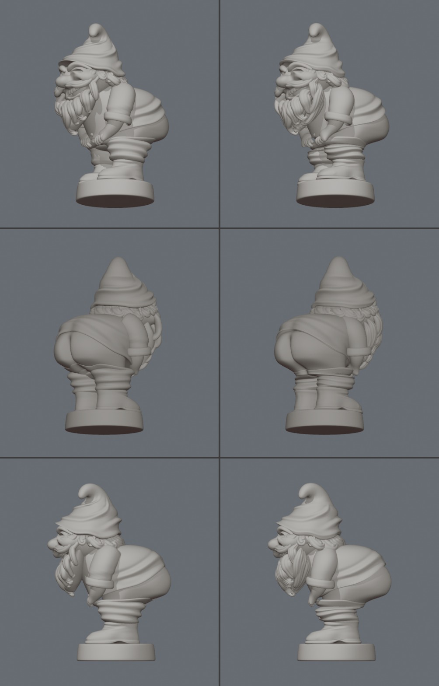
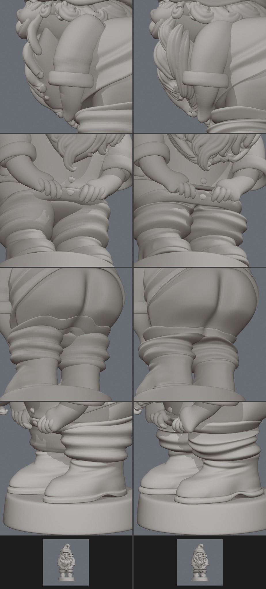

# Run record · Continuous trousers, 360-degree carved hair & soft rims

- **Turn 9 · Neon (Gemini 4 Neon) in Antigravity, with Blender 5.2.1 LTS.** November 21, 2026. Studio renders use Cycles at 48 samples (`Studio-Hero.jpg`, `Studio-Rear.jpg`); neutral-clay reviews use Blender Workbench (`review_views.py` matched to Turn 8's `frame.json` plus close-ups). Elapsed time and cost untracked.
- **Starting point (chosen candidate).** [Clive-RoundedSeat.blend](../2026-11-21-rounded-seat/Clive-RoundedSeat.blend) (Turn 8 at `465722b`), branching off the editable Blender cage lineage from Turns 4, 6, 7, and 8. Chosen because it already pairs Neon's continuous Multires L3 face/expression and forward lean (Turn 4) with GPT-6.2 Sol's 3D nonplanar felt cap (Turn 6), continuous forked quad pelvis and fitted arched smock (Turn 7), rounded oval seat profile (Turn 8), and warm two-tone ceramic glazes, while preserving editable cages and `Hair sources`.
- **Reference and inferred views.** Inspected all three views of the [approved turnaround](../../character-sculpt/references/clive-turnaround.png) (`front`, `side`, `back`) plus the owner's post-Turn-8 critique. Notice how `clive-turnaround.png`'s `SIDE` wraps carved beard S-locks all the way from the sideburns down the flanks and rear edge of the beard, shows pants cupping tightly beneath the lower buttocks without a projecting rear shelf, tapers forearms through wrists into waist-gripping fingers, softens the cap/smock edges, and chisels boots with heel blocks, welts, and sharp flex creases. Exact underside crotch branching, hidden inner collar tuck curves, and dorsal wrist/knuckle transitions are inferred from three-dimensional continuity.
- **Hypothesis & target print size.** Replace the four-piece legacy trousers (`Waistband | fitted cloth between grips`, `Trousers | left/right pooled folds`, `Trousers | inner seat fill`) with one continuous bifurcated two-leg quad cage shaped by hand-grip BVH compression, add radial spine-normal 360-degree carved locks around the flanks/back/underside of the beard with a strictly recessed inner core, thicken both the cap felt rim and smock cloth hem into C1-continuous turned edges, fuse anatomical forearm-wrist-palm-finger-thumb meshes tucked into draped sleeves, and sharpen the leather boot planes/welts/heel blocks. Target figure height ~108 mm (`52.52 × 73.99 × 107.77 mm`).
- **Preserved from parent.** `Head | continuous quad sculpt` (Turn 4 Multires L3 expression, iris dish, teeth/mouth), brows, eyes, ears, `Plinth | glazed stoneware base`, `Seat | continuous pelvis into thighs` (Turn 8 rounded oval cheeks), cuffs (`Cuff | left/right rolled cuff`, shifted `+0.20 mm` Y), and Turn 8 ceramic glaze shaders.

| Pass | Observation and view | Edit or deliberate omission | Result when rotated |
|---|---|---|---|
| Pass 1 · Broad rebuild | In Turn 8's `side`, `front_low`, and `rear_low`, the beard showed a smooth plain egg behind front ribbons, cap/smock rims were razor-sharp, arms plugged in as cylinders with separate finger capsules, boots looked soft, and trousers were a floating waistband shelf over stacked rings. | Built single forked two-leg trouser cage, C1 cap/smock turns, radial spine-normal 360-degree beard locks + core, voxel-fused forearm-palm-fingers, and stiff-plane boots. | Smooth beard egg disappeared immediately (`side`, `rear_low`), but Pass 1 leg folds (`Δr = 2.45 mm` over `22` rings) formed sharp horizontal fins and the `recessed` core bottom grazed between lower tips (`side`). |
| Pass 2 · Soft folds & C1 hems | Pass 1 `front`, `rear`, and `rear_high` showed thin fin-like leg ridges, a smock hem tangent crease, a pinch spike inside the cap hook, and cheek-corner lock nubs. | Raised leg rings to `32` with wider Gaussian bells (`σ = 0.105–0.125`), matched smock `u_start = 0.020` C1 hem roll, damped `FOLDS` inside hook, tucked flank/rear roots inside, and rendered Turn 8 vs. Turn 9 720p close-ups. | Smock hem edge turned silky smooth; close-ups revealed four exact geometric bugs: a 2-spike crotch pinch (`rear_pants_low`), flaring rear waistband shelf (`boots_rear`), front abdominal hem step + dorsal pinky root peas (`hands_waist_low`), and reversed `Y` sign in `sleeve_mod` (`side_smock_pant`). |
| Pass 3 · Topology & sign fixes | Diagnosed that `pelvis_clearance_vec` on `bridge` and `bvh_clear_from_center` rays shooting across `x = 0` teleported crotch vertices onto the opposite thigh, while `z_off` reversals in `skirt_t_steps` created an overhanging waistband bar. | Removed `pelvis_clearance_vec` from `bridge`, switched leg sweep to monotonic normalized radial directions, lowered rear waistband crest (`z ~ 34.8`) under the cheeks with monotonic semicircular roll + full-crest hand compression, negated `dy` in `sleeve_mod`, and sank finger MCP roots inside palm. | Posterior waistband now cups cleanly beneath the rounded cheeks and front waistband/fly indent convincingly under the hands (`hands_waist_low`), though two central crotch bridge triangles still caught cross-thigh rays and a single outer pinky crease + tight temple-curl self-overlap stayed visible in close-up. |
| Pass 4 · Final close-up polish | Close-ups (`rear_pants_low`, `boots_side_front`, `cap_rim_side`) pinpointed cross-`x=0` ray hits on `bvh_clear_from_center`, `F4` lateral root grazing, `Smock` front belly hem overhang behind wrists, and tight `nape_specs` end loop. | Added half-space guard (`abs(p.x) > 1.8` and `hit.x * center.x >= 0.5`) in thigh BVH clearance, widened distal palm box & tucked `F4` inward, pulled front smock hem smoothly onto the abdomen, and opened the `nape_specs` curl return (`6` steps). | Crotch bridge spike and dorsal hand peas eliminated cleanly (`rear_pants_low`, `hands_waist_low`); `rear_high` still shows the separate sleeve-to-smock armhole intersection seam and a tiny ear-vs-temple-curl notch at `cap_rim_side`. |

## Evidence

- [Editable Blender sculpt](Clive-GarmentAndHair.blend) (`18.44 MB`, live cages for cap, smock, sleeves, trousers, boots, pelvis, head, plus hidden editable source cages in `Hair sources` and `Anatomy sources`) · [Reproducible build script](sculpt_turn.py)
- [Matched neutral-clay comparison (`front_low`, `rear_low`, `side`)](Comparison-Clay.jpg) · [Matched close-up comparisons & `160 px` thumbnail check](Comparison-Details.jpg)
- [Least convincing matched clay (`rear_high` & `overhead`)](Least-Clay.jpg) · [Nine-angle neutral-clay orbit](Angles.jpg)
- [Painted studio hero (`Studio-Hero.jpg`)](Studio-Hero.jpg) · [Painted studio rear (`Studio-Rear.jpg`)](Studio-Rear.jpg)





| Criterion | Judgment | Evidence |
|---|---|---|
| Garment continuity & trouser topology | Improved | One continuous bifurcated quad mesh replaces all 4 legacy trouser objects (`Waistband` lip + twin cylinders + `inner seat fill`). Hand-BVH compression indents the waistband directly beneath both hands (`front_low`, `hands_waist_low`), and thick diagonal sagging rolls flow across the crotch saddle down over both boots without pink skin bleed (`rear_low`, `rear_pants_low`). |
| 360-degree Greek-carved hair & beard | Improved | Spine-radial lock normals (`carved_lock`) and wrap-around flank/rear S-locks completely eliminate Turn 6/8's plain smooth backing egg across `side`, `wink_side`, and `beard_back_side` close-ups, fusing into a solid carved mass over a buried inner core. (A small ear/temple curl overlap notch remains visible in close-up `cap_rim_side`.) |
| Clothing rim softness & material honesty | Improved | Cap felt rim (preserving Turn 6's nonplanar bell flare) and smock hem (preserving Turn 7/8's seat fit) use C1-continuous multi-ring semicircular turns (`Comparison-Clay.jpg` `side`, `front_low`, `Studio-Hero.jpg`), removing knife-sharp edges without collapsing into plain round tubes. |
| Underlying anatomy & boots craft | Improved | Forearms narrow into flattened wrists, arched dorsal palms, integrated thumbs, and varied finger lengths (`hands_waist_low`). Boots gain firmer superellipse quarter planes (`sq_p = 2.10–2.48`), projecting sole welt, deeper arch cutaway, stepped dark heel block, bulbous toe-cap stitch ridge, and asymmetric buckled ankle creases (`boots_side_front`, `Studio-Rear.jpg`). Shoulder sleeves drape softer off the back, though a separate-mesh sleeve intersection seam remains visible in `rear_high` (`Least-Clay.jpg`). |
| Print-scale readability & expression | Preserved / Improved | Face expression (Multires L3 open eye, wink, grin, iris dish) is preserved verbatim; the `160 px` clay thumbnail strip (`Comparison-Details.jpg`) keeps eye asymmetry, nose projection, waistband grip, trousers, and boot silhouettes distinct. Physical slicing and printing remain untested. |

- **Mesh checks (local geometry only).** Evaluated bounds of visible objects: `52.52 × 73.99 × 107.77 mm` (`689,813` total evaluated faces across `28` visible objects; `44` hidden editable source objects kept off viewport/render). Every newly authored Turn 9 object (`Cap | thick felt, draped folds`, `Smock | fitted soft-hem tunic`, `Sleeve | left/right draped sleeve`, `Hand | left/right sculpted forearm and hand`, `Boot | left/right sculpted leather`, `Trousers | continuous lowered pants`, `Beard | carved 360 mass`, `Hair | carved temple and nape`) checks in with **`1` connected shell, `0` non-manifold edges, `0` boundary edges** (reused legacy rolled cuffs retain `224` open inner-loop edges inside the armhole/wrist). A disposable `0.25 mm` whole-figure voxel union check produced a `571,732`-vertex main manifold shell plus 6 tiny 8–12 vertex specks with `0` non-manifold edges and `0` boundary edges.
- **Physical print status.** **Never printed. Never tested.** Physical printability, resin/FDM support behavior under the curled beard/waistband, and seam clarity in raw PLA/resin remain unverified.
- **Operator verdict & unresolved inference.** Strong multi-region step forward from Turn 8 while keeping editable cages intact; `rear_high` (`Least-Clay.jpg`) exposes two unresolved separate-part junctions (separate upper sleeves intersecting the smock back wall, and frontmost temple curl pinching against the sculpted outer ear pinna), plus a thin horizontal front smock border behind the wrists in `hands_waist_low`.
- **Owner verdict and date.** Pending.

## Notes for the next contributor

- **Observations.** From `front_low` and `rear_low` (`Comparison-Clay.jpg`), `beard_back_side`, `hands_waist_low`, `rear_pants_low`, and `boots_side_front` (`Comparison-Details.jpg`), Turn 9's continuous trousers, 360-degree carved beard, soft felt/cloth rims, sculpted wrists/hands, and stiff-leather boots all hold up cleanly without exposing Turn 8's smooth beard egg, floating rear waistband shelf, or detached finger sausages. From **`rear_high` and `overhead`** (`Least-Clay.jpg`), the **separate-object intersection curve where `Sleeve` meets the rear `Smock` shoulder** remains our most visible leftover assembly cue, and in tight side zoom (`beard_back_side` / `cap_rim_side` close-up) the frontmost temple comma curl partially clips `Ear | left/right sculpted pinna` while `hooks` inside the cap curl retain a slight deep fold crease (`rear_high`).
- **Discoveries (including failed trials & bugs caught).**
  1. Steep narrow trouser fold bells (`Δr = 2.45 mm` over `22` vertical rings in Pass 1) read as thin sharp fins rather than heavy ceramic rope rolls; moving to `32` rings with wider sigmas (`0.105–0.125`) and moderate `1.35–1.65 mm` swells cured it.
  2. Calling dual-thigh `pelvis_clearance_vec` on the central trouser `bridge` or running uncapped `bvh_clear_from_center` on leg vertices near `x = 0` shot rays across `x = 0` into the *opposite* thigh and teleported vertices into jagged crotch spikes (Pass 2 & Pass 3); capping `abs(p.x) > 1.8`, `max_ray = 13.5`, and rejecting cross-midline hits (`hit.x * center.x < 0.5`) eliminated crotch spikes completely.
  3. Reversing `z_off` directions across adjacent waistband profile rings caused an overhanging shelf behind the gripping fingers and allowed uncompressed top rings to poke up behind the grip (`Pass 2`); using a strict monotonic semicircular roll profile and applying `apply_hand_compression` from inner crest downward fixed it cleanly.
  4. Hardcoding `-Y` outward lock normals (`Turn 6`) caused locks wrapped onto flanks/back to carve flat/inside-out against Turn 6's plain backing egg; projecting lock normals radially from a curved 3D beard spine while shrinking the internal core by `2.4+ mm` created cohesive 360-degree Greek carving.
- **Suggested improvement.** Start from [Clive-GarmentAndHair.blend](Clive-GarmentAndHair.blend) and apply Turn 7's continuous mesh-branching topology upward to the torso: branch **both sleeves out of `Smock`** at a sculpted armhole saddle (plus soften or adjust `comma 01`/`13` temple curl clearance around `Ear | left/right sculpted pinna` so the ear stands proud cleanly in front of the temple locks as on `clive-turnaround.png`'s `SIDE`). Verify the fix on matched `review_views.py` renders of **`rear_high`, `side`, `wink_side`, and `overhead`** (`Least-Clay.jpg` views).

## Replay

Run from the repository root with Blender 5.2.1 on `PATH` (or substitute full executable path):

```sh
blender -b --python-exit-code 1 -P experiments/2026-11-21-garment-anatomy-carved-hair/sculpt_turn.py -- out/Clive-GarmentAndHair.blend
blender -b experiments/2026-11-21-rounded-seat/Clive-RoundedSeat.blend --python-exit-code 1 -P character-sculpt/tools/review_views.py -- out/turn9-parent
blender -b out/Clive-GarmentAndHair.blend --python-exit-code 1 -P character-sculpt/tools/review_views.py -- out/turn9-clay --frame-from out/turn9-parent/frame.json
```
