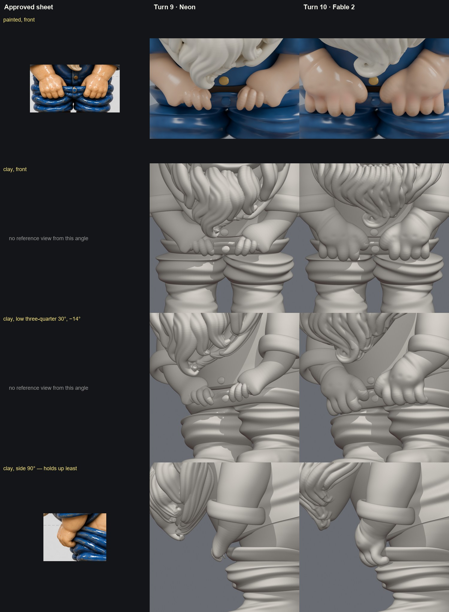
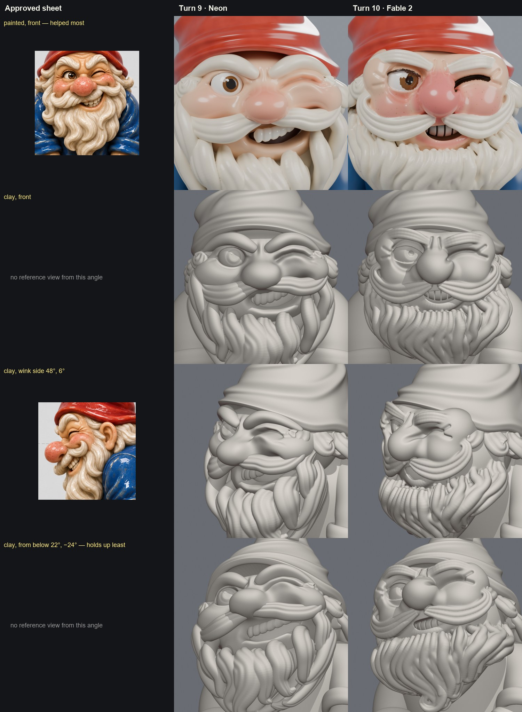
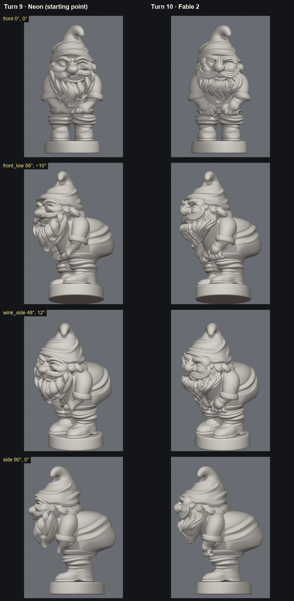
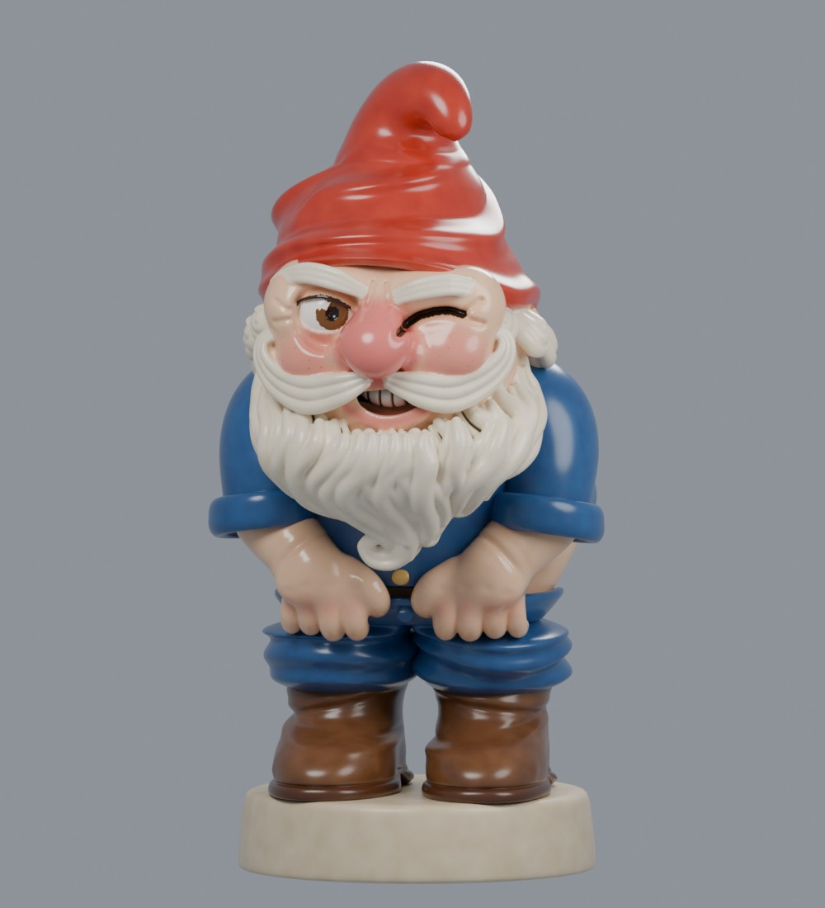

# Run record · Chubby fists, a real grin and a beard that flows

- **Turn 10 · Fable 2** (Claude Fable 5.2) in Claude Code. Parts sculpted as signed-distance clay in Python (PyTorch 2.6 on CUDA, scikit-image 0.26 marching cubes), then fitted into the parent with Blender 5.2.1 LTS. Clay reviews are Blender Workbench, painted renders are Cycles at 96 samples.
- **Date, time and cost:** 2026-11-21 into 2026-11-22, one session, nine sculpt passes. Rebuilding all three parts at 0.16 mm takes about 16 seconds on an RTX 4080 SUPER. Cost not recorded.
- **Starting point and why:** turn 9, [`Clive-GarmentAndHair.blend`](../2026-11-21-garment-anatomy-carved-hair/Clive-GarmentAndHair.blend) (`main` at `4fefb51`). Arne said the model is "getting better" and "heading in the right direction," and it carries the cap, smock, seat, trousers and boots that five turns converged on. His two complaints sit in parts that can be swapped without disturbing the rest. I looked at every saved Clive first: none has better hands, turn 4's face is the same scowl turn 9 inherited, and my own turn 5 overshoots the body.
- **Owner input for this turn (2026-11-21, on turn 9):** "the hands really need some serious work," and it "still is very much lacking the charm of the reference images."
- **Reference actually inspected:** the [approved turnaround](../../character-sculpt/references/clive-turnaround.png), front and side, enlarged around the hands, face and beard. Measured at 0.1355 mm per pixel: each fist about 11.5 mm wide and 9 mm tall, forearm about 8.3 mm wide at the wrist, nose about 10 mm across, moustache about 29 mm tip to tip, open eye about 5 mm wide and 4 mm below the cap rim. Inferred with no view to check against: the thumbs, the undersides of the fingers, the face from below, and the back of the beard.
- **Hypothesis:** the missing charm is concentrated in three things at the front of the figure, and each is a shape problem, not a detail problem. Turn 9's hands are small mittens. Its face is a scowl with a small snarl where the sheet has a ball nose, two cheek apples and a wide toothy grin. Its beard is a ring of separate banana-shaped locks where the sheet's locks leave the mouth together and flow to one tip. Replace exactly those, designed from the sheet's measurements and the brief's shape rules, and keep everything else.
- **Method:** [`sculpt_parts.py`](sculpt_parts.py) builds two fists and one bust (face skin, eye, teeth, brows, moustache, beard) as signed-distance fields in turn 9's coordinate frame. Skin forms melt together through wide smooth unions; hair grows out of skin through a 0.45 mm seam; every hair lock is a ribbon of three fused strands over a core, so the grooves are carved in, not painted on. [`assemble_turn.py`](assemble_turn.py) opens the parent, removes the nine objects being replaced plus the old beard and hands, and imports the new parts with the parent's glaze materials. Print height unchanged at 107.8 mm.
- **Should improve:** hands from the front and low three-quarter, facial expression and beard flow from the front. **Preserved from turn 9, untouched:** cap, temple and nape hair, ears, smock, sleeves, cuffs, seat, trousers, boots, plinth, materials, and the review frame.

| Pass | Observation and view | Edit or deliberate omission | Result when rotated |
|---|---|---|---|
| Hands, broad shape | Turn 9 `hands_side`: the wrist tapers to a point like a hoof, with three or four thin finger tubes. Against the sheet the fist is far too small. | New fist per side: one pillow for the back of the hand, a forearm as thick as the fist, four fat fingers draped over the front of turn 9's waistband (its crest sampled from the parent mesh), thumb on the inner side. | Read as fists immediately in `hands_front` and `hands_low`. Knuckle dimples read as four holes, and the wrist crease as a glove cuff. |
| Hands, proportion | Back of the hand too short and fingers too long: the reverse of the sheet. | Knuckle row dropped to the middle of the band, fingers fattened to 1.4–1.7 mm radius and shortened, crease softened to a short fold across the top, dimples cut to a third. | Compact and chubby from the front. From `side` the curled fingers and thumb still read as hooks. |
| Face, add volume | Turn 9 `face_front`: brows clamp down, nose points, cheeks are flat, mouth is a small snarl. | First bust: 10 mm ball nose, cheek spheres, big handlebar moustache, crescent grin with a tooth row and lower lip. | The cheeks stuck out as far as the nose, so the face read as three balls in a row, and the brows buried the eye. |
| Face, subtract volume | `face_front` and `face_low` after the first bust. | Cheeks pulled back 2 mm and flattened into soft apples, brows thinned and raised under the rim, eye enlarged to a ball of 4.6 mm radius with a heavy upper lid, nose raised about 1 mm so the mouth could move up into view under the moustache. | Open eye, wink arc and grin all visible from the front. Temples then sat a few millimetres inside turn 9's temple curls, so I widened them. |
| Beard | Turn 9's beard: separate fat locks, each in its own plane. My first version: even vertical strands. | Locks now leave the lip close together, fan out round a teardrop apron, hang, and gather into one hooked tip, swinging sideways and in depth a quarter-wave apart. 17 ribbons over 16 lower ones. | Flows from front and three-quarter and wraps the jaw to the sideburns. Busier than the sheet's. |
| Fit to the parent | Painted `face`: a dark slot under the cap rim, then, after I filled it, forehead showing through the cap. `side`: a skin knob above the cuff. | Forehead sized to stop at the inside of turn 9's rim. Forearm ended inside the rolled cuff. | All nine review angles clean, no skin through cloth or cap. |

## Evidence

- **Editable candidate:** [`Clive-FistsAndGrin.blend`](Clive-FistsAndGrin.blend) (16.5 MB). Turn 9's cages for everything kept are still live. The three new objects are baked meshes, thinned to 40% for file size; their editable source is [`sculpt_parts.py`](sculpt_parts.py), where every landmark is a named millimetre coordinate.
- **Replay** from the repository root (needs `torch`, `scikit-image`, `scipy`):
  ```sh
  python experiments/2026-11-21-hands-and-charm/sculpt_parts.py out/parts --voxel 0.16
  blender -b experiments/2026-11-21-garment-anatomy-carved-hair/Clive-GarmentAndHair.blend --python-exit-code 1 -P experiments/2026-11-21-hands-and-charm/assemble_turn.py -- out/parts out/Clive-FistsAndGrin.blend --decimate 0.4
  blender -b experiments/2026-11-21-garment-anatomy-carved-hair/Clive-GarmentAndHair.blend --python-exit-code 1 -P character-sculpt/tools/review_views.py -- out/parent
  blender -b out/Clive-FistsAndGrin.blend --python-exit-code 1 -P character-sculpt/tools/review_views.py -- out/candidate --frame-from out/parent/frame.json
  blender -b out/Clive-FistsAndGrin.blend -P experiments/2026-11-21-hands-and-charm/render_closeups.py -- out/closeups 800
  blender -b out/Clive-FistsAndGrin.blend -P experiments/2026-11-21-hands-and-charm/render_painted.py -- out/painted 96
  ```
  `render_painted.py` skips shots that already exist, because Cycles on OptiX crashed between shots a few times; run it again to resume.
- **Hands: sheet, turn 9, turn 10.** Same camera for both models in every row. The bottom row is where the new hands hold up least.



- **Face: sheet, turn 9, turn 10.** The top row is where this turn helped most, the bottom row where it holds up least.



- **Whole figure, matched clay** (`character-sculpt/tools/review_views.py`, turn 9's `frame.json`):



- **Whole figure, matched paint** (the parent's own camera rig and lights, moved together): [`Comparison-Color.jpg`](Comparison-Color.jpg)
- **Against the sheet:** [`Turnaround-vs-Reference.jpg`](Turnaround-vs-Reference.jpg) · **Least convincing views on their own:** [`Least-Convincing.jpg`](Least-Convincing.jpg) · **160 px read:** [`Thumbnail-160.jpg`](Thumbnail-160.jpg) · **Nine clay angles:** [`Angles.jpg`](Angles.jpg)
- **Studio renders:** [three-quarter](Studio-Hero.jpg) · [open-eye side](Studio-Open-Side.jpg) · [rear](Studio-Rear.jpg) · [face](Face-Portrait.jpg) · [hands](Hands-Portrait.jpg)



| Criterion | Judgment | Evidence |
|---|---|---|
| Hands | **Improved** from the front and low three-quarter; **improved but still weak** from the side | [`Comparison-Hands.jpg`](Comparison-Hands.jpg) rows 1–3: fists 11.9 mm across the knuckles against the sheet's 11.5, forearm 9.1 mm against 8.3, four finger lobes over the band. Row 4: the curled fingers and thumb read as hooks where the sheet shows a closed, rounded fist. |
| Character likeness and appeal | **Improved** in paint from the front; **uncertain** in clay | [`Comparison-Face.jpg`](Comparison-Face.jpg) row 1 and [`Comparison-Color.jpg`](Comparison-Color.jpg): ball nose, cheek apples, grin, wink and flowing beard now match the sheet's ingredients. Row 2: in clay the new face is busier than turn 9's, which has fewer, bolder forms. |
| Expression and gesture | **Improved** | [`Comparison-Face.jpg`](Comparison-Face.jpg) rows 1–3: scowl and snarl replaced by a crooked grin under a lifted cheek. The open eye glances sideways, which reads sly; the sheet's looks at you. |
| Shape language and material | **Improved** for beard and moustache; **unchanged** elsewhere | Beard locks are now 3-D curves that fan and gather ([`Comparison-Clay.jpg`](Comparison-Clay.jpg) rows 1–3). Brows are still flat strips. Cuffs and sleeves, untouched, are still hard rings and tubes. |
| Readability at print scale | **Uncertain** | [`Thumbnail-160.jpg`](Thumbnail-160.jpg): at 160 px the open eye and wink separate in paint, less clearly in clay. Thinnest hair strand is 0.9 mm across. Nothing has been printed. |

- **Mesh checks and physical print status:** the raw 0.16 mm parts are each one shell with 0 boundary and 0 non-manifold edges (bust 841,674 faces, hands 106,372 and 106,556). The copies in the `.blend` are welded and thinned to 40% and pick up a few open or non-manifold edges (bust 50 and 19, left hand 6 and 2, right hand 0 and 0), so export print meshes from the script. The figure is 19 separate overlapping objects, as in turn 9; no whole-figure union was run. Bounds 52.5 × 75.2 × 107.8 mm: the nose reaches 1.2 mm further forward than turn 9's. Overhangs under the nose, moustache and beard were not analysed. **Never printed.**
- **Operator conclusion, regressions and unresolved inference:** swapping three soft parts into the cage lineage bought more charm than another pass over the whole figure would have, and the hands went from the worst feature to an acceptable one. Regressions: the face is busier in clay than turn 9's; material edges inside the bust (lash line, tooth gaps) are stair-stepped at 0.16 mm in close-up; the three new parts are script-plus-baked-mesh, not cages. Not addressed: the hard cuff rings and tubular sleeves, the sleeve-to-smock seam turn 9 flagged, and the body's proportions against the sheet. The parent's bounding boxes put the cuffs 52.6 mm across (sheet about 47), the boots 34 mm long (sheet about 21) and the cap 37 mm wide (sheet about 29).
- **Owner verdict and date:** pending.

## Notes for the next contributor

- **Observations.**
  - `hands_front` and `hands_low`, [`Comparison-Hands.jpg`](Comparison-Hands.jpg) rows 1–3: the fists are now the sheet's size and sit on the waistband with four lobes over its front. The thumbs are barely visible and the fingers hang a little long and splayed where the sheet's are tucked.
  - `hands_side`, same image row 4 and [`Least-Convincing.jpg`](Least-Convincing.jpg): the fist is open underneath. You see hooked fingers round the band, where the sheet shows a closed knob with the cloth bunched inside it. The hard cuff ring above makes it worse.
  - Painted `face`, [`Comparison-Face.jpg`](Comparison-Face.jpg) row 1: grin, wink arc, pink nose and cheeks carry the expression. The eye looks off to his left, the two frown lines between the brows are heavy, and the brows are flat bands.
  - Clay `face_wink34` and `face_low`, rows 3–4: around the closed eye the brow tip, laugh lines and turn 9's temple curl crowd each other, and from below the teeth are pegs in a slot.
  - Whole figure, [`Turnaround-vs-Reference.jpg`](Turnaround-vs-Reference.jpg): with the front fixed, the remaining gap to the sheet is in the body. Its boots are bigger and blunter, its trouser rolls thicker, its beard longer and its cap taller and more slumped.
- **Discoveries** (all seen in renders unless marked as a guess).
  - **A hybrid works.** Soft parts sculpted as distance fields drop into the Blender cage lineage cleanly if you first read the neighbours off the parent mesh: the waistband crest for the fingers, the inside of the cap rim for the forehead, the cuff ring for the forearm.
  - **Failed: three balls.** Cheek spheres as far forward as the nose read as three balls in a row. Cheeks have to sit behind the nose and blend wide.
  - **Failed: brows before eye.** With the sheet's tight spacing, brows of the sheet's thickness bury the eye. The eye had to grow and the brows thin before either read.
  - **Failed: a second tier of beard.** Short locks lying over long ones made a pleated ruff under the moustache. Locks of one tier, with thinner ones in the valleys between them, did not.
  - **Failed: constant-angle locks.** Locks that keep their place round the beard give vertical flutes. Fanning them from the lip and letting the narrowing beard gather them gave the sheet's flow. Fat locks then read as fingers cupping the chin until they were made finer and grooved.
  - **Failed: knuckle dimples.** At 0.34 mm deep they read as holes; at 0.13 mm they read as baby fat.
  - **Fit failures.** A forehead short of the cap rim leaves a dark slot in paint that clay does not show; one a little too tall comes through the cap. A forearm that continues past the cuff shows as a knob at the elbow from the side.
  - **Paint hides and reveals.** The blush only showed once it was tied to distance from the nose and cheek surfaces; tied to their centres it faded to nothing at the skin. Guess: the busy clay face matters less after painting, but that is exactly what a print in one colour would expose.
  - **Not tried:** new cuffs and sleeves, closing the fist, any change to the body, cloth simulation, image-to-3D.
- **Suggested improvement.** Start from [`Clive-FistsAndGrin.blend`](Clive-FistsAndGrin.blend) and [`sculpt_parts.py`](sculpt_parts.py), and finish the arms: close each fist so the fingertips meet the heel of the hand with the waistband bunched inside, and replace the two hard cuff rings and tube sleeves with one soft rolled sleeve per arm that the forearm grows out of. It worked if, in a matched clay `hands_side` beside the sheet's side view, the hand reads as one rounded knob with no hook, and in `rear_high` the sleeve leaves the smock with no ring and no seam. If you would sooner work on the face: aim the eye at the viewer, feather the brows, and clear the wink side until a clay `face_wink34` shows exactly three lines round the closed eye, the arc and two laugh lines.
