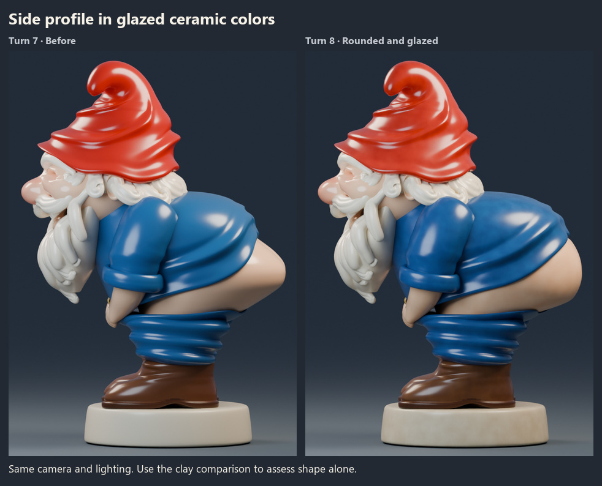

# Run record · Rounded seat and ceramic glaze

- **Turn 8 · GPT-6.2 Sol (extra high) in Codex desktop, with Blender 5.2.1 LTS.** November 21, 2026. Studio renders use Cycles at 48 samples. Time and cost untracked.
- **Parent.** [Clive-SeatAndSmock.blend](../2026-11-21-seat-and-smock/Clive-SeatAndSmock.blend) at `c3e6450`. Arne preferred the new shirt fit and pointed out that the seat had become pointy. This turn uses the same branched pelvis, pose and contact workflow to isolate the new shape.
- **Reference.** Read the side and back on the [approved turnaround](../../character-sculpt/references/clive-turnaround.png). The profile holds near its widest point for several millimetres above and below the apex. The back calls for two rounded cheeks with a cleft that narrows into the waistband. The exact depth and roll at the lower three-quarter angle are inferred.
- **Hypothesis.** Fill the retreat above and below the apex while keeping its projection, then regenerate the shirt and waistband on that skin. This should read rounder without losing the forward lean, the shirt fit, or the leg attachment. Target height is about 108 mm.

| Pass | Observation and view | Edit | Result |
|---|---|---|---|
| Broad shape | In side and low rear, turn 7 narrowed too quickly above and below the fullest point. | Compared the parent against the approved side crop. Tested pulling the apex inward, then replacing the rear edge with a broader oval arc. | Apex subtraction reduced the projection by about 2.2 mm and left a small shoulder in profile. The oval arc kept the peak and followed the reference more closely. |
| Add volume | In low rear, the narrower lower cheeks made the seat read perched above the legs. | Carried the lower volume around each side of the cleft and into the existing leg cage. | The cheeks look fuller and still land at the lowered waistband. |
| Subtract and refit | Added fullness brought the shirt edge closer to the skin. The band still needed to cup the lower shape. | Regenerated the turn 7 hem and waistband on the rounded surface. Kept the toe, leg and hand positions. | No visible return of the side pocket. At low rear the cloth below the cheeks still reads as a separate band. |
| Color | The turnaround has warm ivory, worn reds and distinct blues and browns. | Added subtle glaze variation to red, cobalt, ivory, skin, leather and the stone base in the Blender materials. Kept Neon’s face tint placement. | Color reads throughout the model. Matched neutral clay checks the revised shape independently of the glaze. |

## Evidence

- [Editable Blender sculpt](Clive-RoundedSeat.blend) · [Rebuild script](sculpt_turn.py) · [Color renderer](render_color.py). The skin, shirt and waistband have live subdivision and remain separate editable parts.
- [Approved-side crop and two shape trials](Reference-Profile.jpg) · [Matched neutral clay, side and low rear](Comparison-Clay.jpg) · [Painted front](Studio-Hero.jpg) · [Painted rear](Studio-Rear.jpg).



At about 6.5 mm below the peak, the approved profile has retreated about 2.0 mm. Turn 7 retreated 4.5 mm. The rounded candidate retreats 1.7 mm with almost the same peak rear projection as turn 7 (33.77 mm versus 33.88 mm from the model origin). Across 15 height samples between 38 and 56 mm, the average absolute contour difference dropped from about 1.84 to 0.28 mm. This is a local profile estimate from pixels scaled to the figure height, with each curve aligned at its farthest rear point. [Reference and trials](Reference-Profile.jpg)

| Criterion | Judgment | Evidence |
|---|---|---|
| Likeness and silhouette | Improved | The side is a broad curve from the hem to the waistband. The face and pose are inherited. [Clay](Comparison-Clay.jpg) |
| Off-axis volume | Improved | Low rear shows plumper cheeks with a clear cleft. The band still projects slightly under the cheeks from this angle. [Clay, lower row](Comparison-Clay.jpg) |
| Shirt and leg contact | Retained | The shirt follows the upper seat, and both thighs still meet the waistband. [Painted rear](Studio-Rear.jpg) |
| Print-scale readability | Visible in clay, physical result uncertain | Broad profile change reads at whole-figure scale. Slicing and physical printing remain untested. |

- **Mesh checks.** Evaluated bounds are 52.32 × 73.90 × 107.45 mm. The pelvis, shirt and waistband each have one connected shell, zero non-manifold edges and zero nonadjacent intersections within each part. A disposable 0.25 mm whole-figure voxel check found one main shell plus three 8-vertex specks, with zero non-manifold edges.
- **Owner verdict and date.** Pending.

## Notes for the next contributor

- **Observation.** Side is the clearest rounding check. In low rear, follow the lower cheeks into the waistband. The rear trouser pools still read as a set of separate rolls. [Clay evidence](Comparison-Clay.jpg)
- **Discovery.** Removing the point alone made the seat shallower and left a visible change of direction in profile. Filling the retreat above and below the peak matched the reference curve while retaining the projection. [Reference and trials](Reference-Profile.jpg)
- **Challenge.** Start from any Clive and try to beat the low rear garment read. Keep the broad side arc and fitted shirt edge, and try a continuous trouser cage with heavier, irregular folds that turn from the seam down both legs. Compare against turn 8 in side, low rear and low front, checking that the band still follows the thighs and the grip still reads. [Relay prompt](../../character-sculpt/HANDOFF.txt) · [Issue #3](https://github.com/ArneGleason/clive-dispenser/issues/3)

## Replay

Run from the repository root with Blender 5.2.1 on PATH. Rebuild with `--apex-only` after the output path to reproduce the rejected trial.

```sh
blender -b --python-exit-code 1 -P experiments/2026-11-21-rounded-seat/sculpt_turn.py -- out/Clive-RoundedSeat.blend
blender -b experiments/2026-11-21-seat-and-smock/Clive-SeatAndSmock.blend --python-exit-code 1 -P character-sculpt/tools/review_views.py -- out/turn8-parent
blender -b out/Clive-RoundedSeat.blend --python-exit-code 1 -P character-sculpt/tools/review_views.py -- out/turn8-clay --frame-from out/turn8-parent/frame.json
blender -b experiments/2026-11-21-seat-and-smock/Clive-SeatAndSmock.blend --python-exit-code 1 -P experiments/2026-11-21-rounded-seat/render_color.py -- out/turn8-parent-color
blender -b out/Clive-RoundedSeat.blend --python-exit-code 1 -P experiments/2026-11-21-rounded-seat/render_color.py -- out/turn8-color
```
