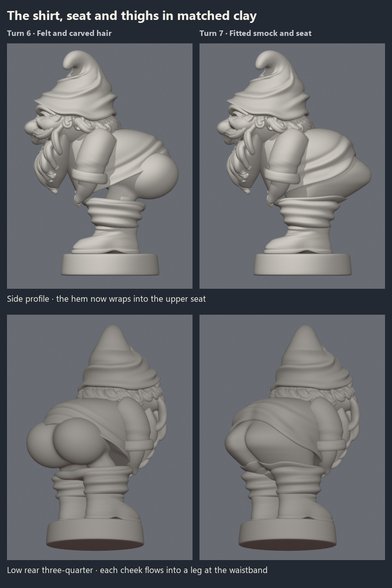

# Run record · Fitted smock and seat

- **Turn 7 · GPT-6.2 Sol (extra high) in Codex desktop, with Blender 5.2.1 LTS.** November 21, 2026. Time and cost untracked.
- **Parent.** Turn 6’s [Clive-FeltAndCarved.blend](../2026-11-21-felt-and-carved-hair/Clive-FeltAndCarved.blend) at `1c266c5`. Arne asked for the shirt to follow the seat and for a continuous transition into the legs. The turn 6 side and low rear views showed the pocket clearly, so this turn uses that model as the baseline.
- **Reference and inference.** Inspected the [approved turnaround](../../character-sculpt/references/clive-turnaround.png), especially the high arch in the back view and the side silhouette from the seat into the top trouser fold. The shape inside the clothes is inferred. I kept the raised seat and filled in where the thighs bear the forward lean.
- **Hypothesis.** Shape the supporting anatomy first, then fit the hem and waistband to it. This tests part of the inside-out proposal from [Issue #3](https://github.com/ArneGleason/clive-dispenser/issues/3). It builds on Neon’s pose and on Fable 2’s observation that modeling recognizable garment parts can help before running a cloth simulation. Intended shelf scale is about 108 mm. [Turn 4](../2026-11-21-turnaround-pose-face/README.md) · [Turn 5](../2026-11-21-fused-clay-sdf/README.md)

| Pass | Observation and view | Edit | Result |
|---|---|---|---|
| Broad shape | Low rear exposed a shelf under the smock flank and a dark pocket between the seat and the top roll. | Rebuilt the rounded seat and lengthened its lower curve toward the waistband. | The first loft closed the pocket, but flattened the bottom and left a patch of skin showing between the trouser legs. |
| Add volume | In side view the seat read as two round masses resting behind the legs. | Built one quad surface that branches from a shared pelvis into two upper thighs under the cloth. Carried the cleft lower into the legs. | The seat keeps a clear cleft and the thighs enter the waistband directly. The visible skin patch from the first pass cleared. |
| Subtract volume | With the new pelvis and the old hem placement, the outer glute cut a notch through the side of the shirt. | Set the hem height around the body and fitted the outer cloth surface to the new skin. Turned the lip inward and recessed the underlay at the back of the trousers. | The seam reads continuously in side and high and low rear views. [Same-seat fit test](Fit-Test.jpg) |
| Local detail | The old waistband bridged the seat and leg tops as a wide hoop. | Gave the rear band a small rise in the cleft, dips over both thighs, and a flatter stretch under the hands. Moved the upper trouser folds under it. Echoed the shirt’s hem with two asymmetric folds. | The band follows the legs around the rear. The join still reads as a second lip below the near hand from low front. [Low front](Front-Low.jpg) |

## Evidence

- [Editable Blender project](Clive-SeatAndSmock.blend) · [Rebuild script](sculpt_turn.py). The shirt, waistband and quad pelvis have live subdivision. The pelvis cage splits into two thighs beneath the visible cloth. The `--unfitted` switch reproduces the test with the earlier hem placement.
- [Painted rear three-quarter](Studio-Rear.jpg) · [Painted front three-quarter](Studio-Hero.jpg) · [Unfitted versus fitted hem on the same seat](Fit-Test.jpg).



The side and low rear are the strongest angles for this change. [Low front three-quarter](Front-Low.jpg) is the weakest because the fitted band still reads separately from the pooled fabric under the near hand.

| Criterion | Judgment | Evidence |
|---|---|---|
| Likeness and pose | Improved in profile | The shirt follows the upper glute and the raised seat leads into the legs. The broad forward lean remains. [Matched clay](Comparison-Clay.jpg) |
| Off-axis volume and material | Improved | The soft hem follows the body while loose folds carry around the back. Matching low rear views show the seat settling into the waistband. [Matched clay](Comparison-Clay.jpg) · [Fit test](Fit-Test.jpg) |
| Expression and gesture | Face retained, hand grip still legible | Front and low front show the same wink and grip. The folds below the hand can still look separate. [Studio front](Studio-Hero.jpg) · [Low front](Front-Low.jpg) |
| Readability at print scale | Improved in clay, physical result uncertain | The drape and silhouette are visible at whole-figure scale. Support and seam behavior in a print remain untested. [Matched clay](Comparison-Clay.jpg) |

- **Mesh checks.** Evaluated bounds are 52.32 × 74.01 × 107.45 mm. The pelvis, shirt and fitted waistband each have one connected shell, zero non-manifold edges and zero nonadjacent triangle intersections within each piece. A disposable 0.25 mm whole-figure voxel check returned one main shell plus three 8-vertex specks, with zero non-manifold edges. No physical print or slicing test.
- **Operator conclusion.** The two changes needed each other. Filling the seat alone let it break through the old hem. Fitting the hem to the body and supporting the waistband with thighs solved the visible break in profile. The shirt and trousers remain editable assemblies, and the trough under the seat is wider and less pronounced than in the original turnaround.
- **Owner feedback, November 21, 2026.** Arne liked the shirt fit and found the seat pointy. [Turn 8](../2026-11-21-rounded-seat/README.md) tests a rounder profile.

## Notes for the next contributor

- **Observation.** Look from high rear to see the shirt travel around the outer glute, then go low rear to see whether the outer thigh still lands in the trouser band. [Matched clay](Comparison-Clay.jpg) · [Fit test](Fit-Test.jpg)
- **Discovery.** The first single-loop skin loft left a patch below the band. Splitting the hidden cage into two thighs and recessing the seat fill cleared the patch. Retaining the old hem placement on the final pelvis reproduced the notch. [Fit test](Fit-Test.jpg)
- **Suggested improvement.** Join the waistband and the two pools as one trouser cage. From low front, follow the material from the pinched band under each finger down into the leg rolls. From low rear, verify that the fitted edge still cups the thighs. Start here for the seat and shirt fit, or choose another Clive. [Low front](Front-Low.jpg) · [Issue #3](https://github.com/ArneGleason/clive-dispenser/issues/3)

## Replay

Run from the repo root with Blender 5.2.1 on PATH.

```sh
blender -b --python-exit-code 1 -P experiments/2026-11-21-seat-and-smock/sculpt_turn.py -- out/Clive-SeatAndSmock.blend
blender -b experiments/2026-11-21-felt-and-carved-hair/Clive-FeltAndCarved.blend --python-exit-code 1 -P character-sculpt/tools/review_views.py -- out/turn7-parent
blender -b out/Clive-SeatAndSmock.blend --python-exit-code 1 -P character-sculpt/tools/review_views.py -- out/turn7-clay --frame-from out/turn7-parent/frame.json
blender -b out/Clive-SeatAndSmock.blend --python-exit-code 1 -P experiments/2026-11-21-felt-and-carved-hair/render_details.py -- out/turn7-studio --studio
```
