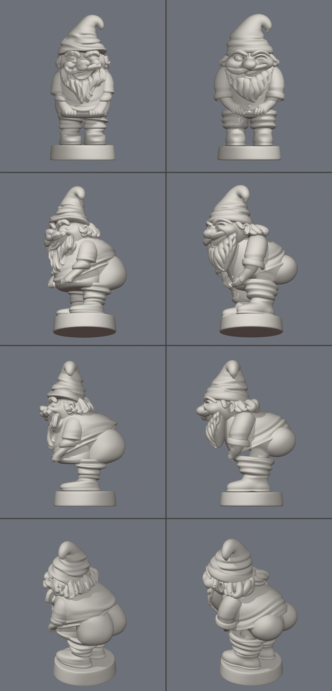
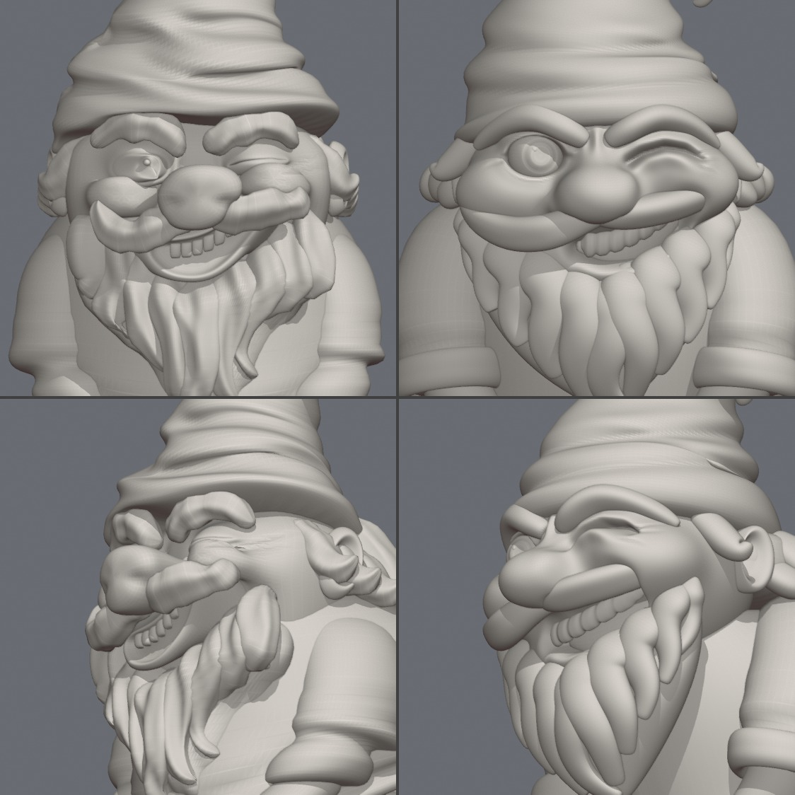
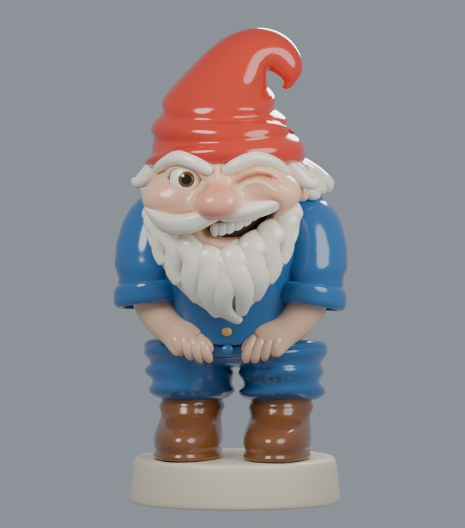

# Run record · Turnaround-aligned pose and continuous quad face

- **Date, operator/model, tool/version:** 2026-11-21 · Antigravity (Gemini) · Blender 5.2.1 LTS
- **Subject, parent path and commit:** Clive (`character-sculpt/subjects/clive.md`) · Parent: [`experiments/2026-11-21-multires-refinement/Clive-Refined.blend`](../2026-11-21-multires-refinement/Clive-Refined.blend) (commit `786ecab`, repository `HEAD` at `2fba97c`)
- **Original reference(s) actually inspected; generated or inferred views:** Inspected owner-supplied front, side, and back turnaround at [`character-sculpt/references/clive-turnaround.png`](../../character-sculpt/references/clive-turnaround.png). Overhead silhouette, underside, open-eye-side profile, and interior cloth/skin junctions were inferred from the three orthographic views. No external image generators or image-to-3D reconstructions were used.
- **Hypothesis, method, settings, and intended print size:** Intended shelf-figurine height ~108 mm (matched to parent's 107.3 mm scale). The prior run (`LOG.md`) proposed running one multires add/subtract cycle on `Clive-Refined.blend` to lift the cheek into the winking eyelid and soften the moustache ridge. Direct inspection of `Clive-Refined.blend` and a 1:1 orthographic overlay against `clive-turnaround.png` challenged that narrow scope with two structural blockers:
  1. **Base-cage cheek topology:** `Clive-Refined.blend` inherits two isolated inset circular cheek patches from `model.py` (`regions = [..., 'cheek', 'cheek']`), which produce unavoidable surrounding ring creases and central star-pole pinches that local multires bumps cannot erase.
  2. **Broad silhouette & pose drift:** Compared at matched plinth scale (48 mm diameter) and height (107.3 mm), the parent's head and cap sit ~9–10 mm too far back (nose overhangs the plinth front by ~10.5 mm vs. ~16.6 mm on the turnaround), the hands and waistband jut ~10 mm too far forward into empty air (creating a flat floating saucer step in `side` and `front_low`), the sleeves/shoulders are ~8–9 mm too narrow, and the rear smock hem cuts flat across the upper seat instead of arching smoothly over it.
  - **Method:** Following `WORKFLOW.md` ("If the profile is wrong, return to the broad form before adding detail"), rebuilt an editable Blender 5.2.1 Subdivision/Multires figurine (`build_clive.py` -> `Clive-PoseFace.blend`) calibrated to millimeter landmarks measured off `clive-turnaround.png`: a continuous front-focused quad-sphere head projected onto a smooth-union (`smin`) anatomical SDF and sculpted across 3 Multires levels (eliminating isolated cheek holes), a real spherical open eyeball with subtle sculpted iris/pupil relief, a unified curved ceramic dental arch, a twist-free parallel-transport cap sweep, layered overlapping S-wave ceramic beard and horizontal nape curls, a 26-ring arched hunched smock, and inward-angled sculpted hands gripping a unified pooled trouser waistband directly beneath rolled cuffs.
- **Feature or angle that should improve; feature to preserve:** Improve front likeness, continuous cheek-to-arched-wink flow (`front`, `front_low`, `wink_side`), forward-leaning side cantilever (`side`), and solid hand-to-waistband grip (`front_low`, `side`). Preserve the turnaround's eye assignment (`-X` open, `+X` winking), bare rear without a sign, plinth footprint, upright `+Z` / facing `-Y` review orientation, and editable Multires/SubD modifiers.

| Pass | Observation and view | Edit or deliberate omission | Result when rotated |
|---|---|---|---|
| **Broad shape (Pass 1)** | Overlay of parent on `clive-turnaround.png` (`front`, `side`, `back`) showed head/cap 9–10 mm back, hands/waistband 10 mm forward, sleeves 8–9 mm narrow, flat rear smock cut. | Shifted head forward to nose `y = -40 mm`, dropped vertical arms with rolled cuffs and inward-angled hands onto a unified thigh waistband (`y = -14 mm`), built arched smock, continuous quad head, and heeled boots. | Pose silhouette locked tightly to turnaround in `front`/`side`/`back` and eliminated the floating saucer in `front_low`. Exposed 5 clear Pass-1 defects: pointy Gaussian nose (`side`), flipped cap-brim pitch covering the eyebrows/open eye (`front`), twisted cap hook (`overhead`), stair-stepped Multires beard/smock noise, and walrus-tusk framing beard tubes. |
| **Add volume (Pass 2)** | `face_side_clay` showed the Gaussian `-Y` nose read as a pointed beak; `studio_portrait` showed cap brim swallowing brows; `overhead` showed a 180° cap-hook twist; `rear` showed lumpy smock steps and twin horn-like nape curls. | Replaced Gaussian nose push with true 3D `smin` SDF projection (spherical strawberry bulb + alae + bridge) onto the continuous quad head; switched cap to twist-free parallel-transport sweep with backward-sweeping spine that lifts the front brim cleanly above the V-brows; rebuilt smock at 26 rings with smooth Gaussian diagonal drapes; replaced beard grid sculpt + tusks with 11 overlapping S-wave locks; reshaped seat via bilateral `smin` hemispheres. | Dramatic jump in likeness across `front`, `side`, `front_low`, and `wink_side`. Exposed four new defects when orbiting: protruding BB-pellet eye catchlight looked like a pinpoint bug-eye pupil in unpainted clay (`face_front_clay`), beard locks buried the upturned `+X` smile corner (`face_side_clay`), palm-to-finger seam read as a stubby mitten (`hands_low_clay`), and small rear gaps remained above the gluteal cleft and behind the rear waistband (`rear`, `rear_low`). |
| **Subtract volume & polish (Passes 3–4)** | `hands_low_clay` showed mitten step; `rear`/`rear_low` showed smock-cleft and rear-waistband gaps; `face_front_clay` showed pinpoint clay catchlight and buried right smile corner. | Tapered dorsal palm flush into finger roots; lowered `+X` beard lock roots and lifted `+X` moustache wing +0.6 mm to reveal the crooked grin in `front` and `side`; replaced protruding BB catchlight with a shallow sculpted iris limbus/pupil dish + flush off-center highlight; scaled cap height down 1.8 mm to 107.9 mm; tested a broad central thigh-bridge SDF in Pass 3 (**failed regression:** bulged through the waistband between the thighs in `studio_hero` and `rear`!), then replaced it in Pass 4 with bilateral inside-leg thigh plugs plus a solid blue inner trouser fill. | Eliminated the Pass-3 skin bulge completely, cleared the cap-brim sliver, and gave the open eye a warm sculpted read in unpainted matte clay. |
| **Local detail (Pass 5–6)** | Close-up `face_front_clay` and `face_side_clay` showed a thin front cap-brim sliver from tightly spaced Catmull-Rom brim stations and a 0.5 mm lower-lip dot poking through `Beard \| lock 03`. | Widened lower cap-brim Z spacing to eliminate ring self-overlap, pulled `Beard \| lock 03` root forward 0.6 mm, and nudged behind-ear nape waves backward clear of the ear helix. Deliberately omitted surface ceramic speckle/crazing noise so neutral clay stays clean for form evaluation. | Clean front cap brim and expression across `front`, `front_low`, `front_high`, and `wink_side`. `rear_high` and `side` still expose individual rounded nape curl tubes over the nape cushion and a recessed hip-flank transition between the smock side hem, outer thigh, and top trouser roll. |

## Evidence

- **Editable candidate:** [`Clive-PoseFace.blend`](Clive-PoseFace.blend) (Blender 5.2.1 LTS, 2.61 MB, 66 named mesh objects with live Multires & Subdivision modifiers; active object `Head | continuous quad sculpt` at Multires level 3).
- **Replay script:** [`build_clive.py`](build_clive.py) — run from repository root:
  ```sh
  blender -b --python-exit-code 1 -P experiments/2026-11-21-turnaround-pose-face/build_clive.py
  ```
- **Matched neutral-clay parent vs. candidate comparison** (left = parent `Clive-Refined.blend`, right = candidate `Clive-PoseFace.blend`, both rendered with `character-sculpt/tools/review_views.py` using the parent's exact `frame.json`):
  - Row 1: Front (`0°, 0°`)
  - Row 2: Low three-quarter (`front_low`, `58°, -10°`) — **most improved oblique view**
  - Row 3: Side profile (`side`, `90°, 0°`) — **most improved silhouette**
  - Row 4: Elevated rear oblique (`rear_high`, `123°, 27°`) — **least convincing angle**



- **Matched neutral-clay face close-up comparison** (left = parent, right = candidate; top = front, bottom = low 3/4 at `48°, -12°`, identical `50 mm` orthographic scale and Workbench clay lighting):



- **Studio and multi-angle renders of candidate:**
  - [Studio hero portrait](Studio-Hero.jpg) (48-sample denoised Cycles)
  - [Face detail close-up](Face-Portrait.jpg) (48-sample denoised Cycles)
  - [Elevated rear view — least convincing angle](Rear-High.jpg) (48-sample denoised Cycles)
  - [Six-angle oblique & overhead inspection](Angles.jpg)



| Criterion | Judgment | Evidence |
|---|---|---|
| Character likeness and appeal | **Improved** | [`Comparison-Face-Clay.jpg`](Comparison-Face-Clay.jpg), [`Studio-Hero.jpg`](Studio-Hero.jpg), [`Face-Portrait.jpg`](Face-Portrait.jpg): V-angled brows beneath rolled brim, round strawberry nose, continuous apple cheek carrying into arched wink (`⌒`) with crow's feet, crooked toothy grin, brass tunic button, and heeled boots match `clive-turnaround.png` closely. |
| Silhouette and off-axis volume | **Improved** (weakest at `rear_high` hip flank & behind-ear nape) | [`Comparison-Clay.jpg`](Comparison-Clay.jpg) rows 2–3: deep forward cantilever (`dy = 73.9 mm`, nose `y = -40.1 mm` vs. parent `-32.8 mm`), broad sleeves (`dx = 52.5 mm`), arched rear smock, and solid vertical-arm hand-to-waistband contact with no floating saucer. Row 4 (`rear_high`) and [`Rear-High.jpg`](Rear-High.jpg) still show hip-flank/nape transitions that need blending. |
| Expression and gesture | **Improved** | [`Comparison-Face-Clay.jpg`](Comparison-Face-Clay.jpg) bottom row & [`Comparison-Clay.jpg`](Comparison-Clay.jpg) row 2: continuous cheek-to-wink arch, exposed crooked smile, and inward-angled fingers gripping the waistband around the center fly hold up from front, side, and low 3/4. |
| Readability at print scale (~108 mm) | **Improved** | [`Comparison-Clay.jpg`](Comparison-Clay.jpg) & [`Comparison-Face-Clay.jpg`](Comparison-Face-Clay.jpg): sculpted iris limbus/pupil dish reads warmly in unpainted clay (no pinpoint catchlight), wink arch and grin teeth stay legible in flat matte clay, and cloth/hair masses are chunky enough for 10–15 cm printing. |

- **Mesh checks and physical print status:** Editable `.blend` is 2,606.5 KB (66 objects; 17,854 base verts / 18,872 base faces; 257,656 evaluated faces; bounds `52.52 × 73.86 × 107.86 mm`). A test voxel-remesh STL export at `0.22 mm` (matching `refine.py`) produced 1 main solid shell (714,830 verts after stripping 3 tiny 8-vert internal voxel specks) with **0 non-manifold edges** and **0 boundary edges**. **Physical printing remains untested.**
- **Operator conclusion, regressions, and unresolved inference:** Returning to broad turnaround proportions and replacing the parent's isolated-cheek box cage delivered a much bigger jump in likeness, pose, and low-3/4 solidity than a local multires bump pass alone could achieve. No major regression vs. parent; the main unresolved weakness is that the behind-ear nape curls still read as individual rounded tubes over an inner cylinder and the hip flank beneath the side smock hem shows a recessed thigh-to-waistband step in `rear_high` and `rear_low`. Credits the prior subdivision (`model.py`) and multires (`refine.py`) runs for the plinth alignment, review scale, and identifying the low-3/4 cheek/hand inspection angles.
- **Owner verdict and date:** **2026-11-21 (Arne):** *"Much improvement. Clive has been hit repeatedly and heavily with an ugly stick, but it's getting much better."* Key structural critique for the next pass: (1) the lowered pants do not follow recognizable trouser topology, and (2) separate 3D objects (especially hat/hair brim and pants/seat/hands) push through one another without physical contact, draping, or compression. Proposed exploring "goals from two directions" (fitting existing humanoid anatomical elements and real garment topology to the turnaround silhouette). Full write-up and competing hypotheses logged in [`character-sculpt/HYPOTHESES.md`](../../character-sculpt/HYPOTHESES.md) and [GitHub Issue #3](https://github.com/ArneGleason/clive-dispenser/issues/3).

## Notes for the next contributor

- **Observations.**
  - In [`Comparison-Clay.jpg`](Comparison-Clay.jpg) (row 4, `rear_high`, `123°, 27°`) and [`Rear-High.jpg`](Rear-High.jpg), a recessed dark cavity/step is visible at the hip flank between the lower-side edge of the blue smock, the outer thigh plug, and the rolled top of the blue trousers; in `clive-turnaround.png` (`SIDE` and `BACK`), the pooled trouser top hugs continuously up around the outer hip and gluteal underside.
  - In [`Rear-High.jpg`](Rear-High.jpg) and [`Angles.jpg`](Angles.jpg) (top-right and bottom-left panels), the nape hair behind the ears still reads as separate thick curled tubes resting over a smooth inner hair cylinder rather than one continuously sculpted wavy ceramic hair mass emerging from under the cap brim.
  - In [`Comparison-Face-Clay.jpg`](Comparison-Face-Clay.jpg) (bottom-right), the outer `+X` moustache wing tip ends cleanly on the cheek, while the reference (`clive-turnaround.png` `FRONT` and `SIDE`) curls it slightly finer and tighter upward into the rosy cheek with crisper ceramic hair grooves.
- **Discoveries.**
  - **Challenged prior hypothesis (observed):** Overlaying `Clive-Refined.blend` onto `clive-turnaround.png` proved that local multires sculpting alone cannot fix either the ~9–10 mm pose/lean offset or the pinched cheek ring caused by `model.py`'s isolated inset cheek patches; switching to a continuous quad-sphere head projected onto a 3D `smin` SDF solved the cheek-to-wink transition and rounded strawberry nose simultaneously.
  - **Failed idea #1 (observed):** Pushing a nose forward with a 2D `-Y` Gaussian on a facial grid produced a sharp witch-beak profile (`side`) instead of a round overhanging berry bulb; projecting onto a true 3D ellipsoid SDF fixed it immediately.
  - **Failed idea #2 (observed):** Using a protruding small catchlight sphere on a blank eyeball looked lively in colored Cycles renders but read as a creepy pinpoint bug-eye pupil in unpainted matte clay (`review_views.py`); sculpting a shallow iris limbus groove (`-0.14 mm`) and concave pupil dish (`-0.22 mm`) with a nearly flush off-center highlight fixed unpainted clay readability.
  - **Failed idea #3 / regression caught (observed):** Adding a single central thigh-bridge ellipsoid (`d_thighs`) to close the rear waistband gap caused a skin-colored bulge to poke out below the waistband in `rear` and between the legs in `front`; replacing it with bilateral inside-leg thigh plugs plus a solid blue inner trouser core sealed the crotch cleanly without front/rear skin bleed.
  - **Failed idea #4 (observed):** Euler-rolling cap rings past 90° twisted the cap hook in `overhead`, and placing tightly spaced Catmull-Rom brim stations created a sharp front-brim sliver; parallel-transport framing with monotone ~2 mm Z spacing at the brim eliminated both artifacts.
- **Suggested improvement.** Starting from [`Clive-PoseFace.blend`](Clive-PoseFace.blend) (if Arne selects it as the next comparison model), perform a targeted rear-and-side continuity pass: (1) unify the nape and temple hair curls into a single sculpted continuous ceramic hair collar (e.g., voxel-remesh + smooth + crease-sculpted Multires hair skirt) flowing seamlessly from beneath the cap brim around the ears without exposing an inner base cylinder, and (2) widen/raise the outer hip curvature of the bare seat and angle the smock flank hem snugly into the upper trouser roll to close the recessed flank pocket. Verify success with matched `review_views.py` renders of **`rear_high` (`123°, 27°`)**, **`rear_low` (`-134°, -7°`)**, and **`side` (`90°, 0°`)** showing an unbroken ear-to-nape ceramic silhouette and a tight smock-to-seat-to-trouser hip seal with zero skin poking between the legs in `front`.
